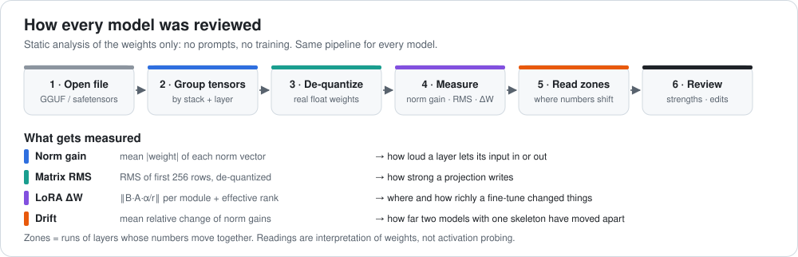
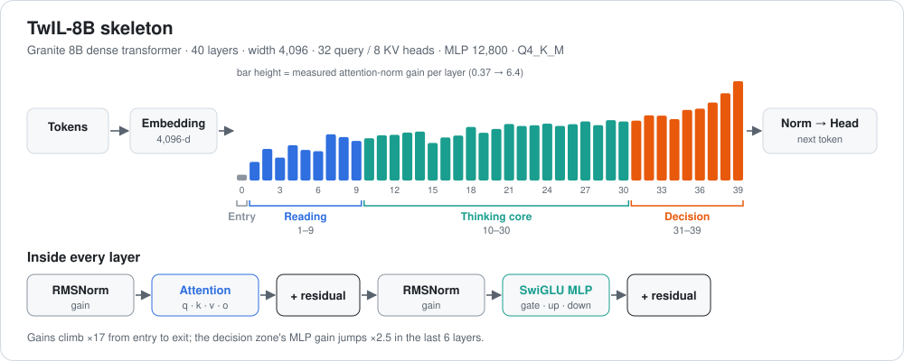
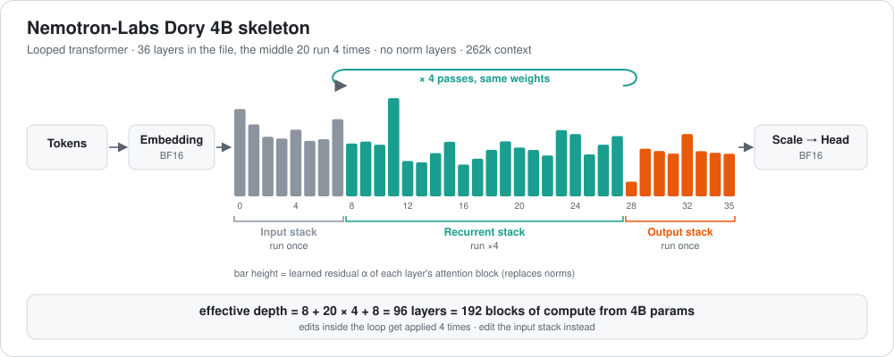
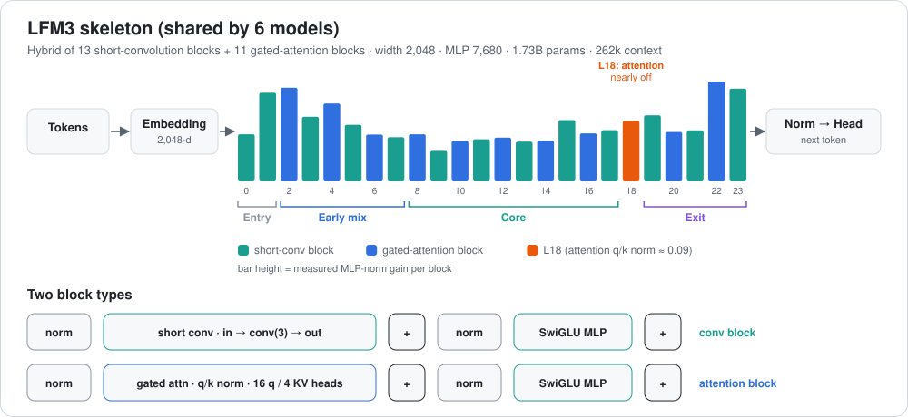
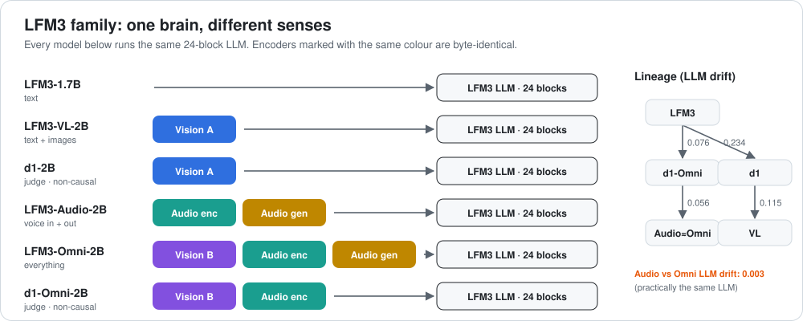
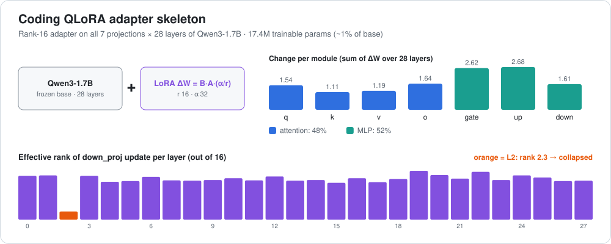
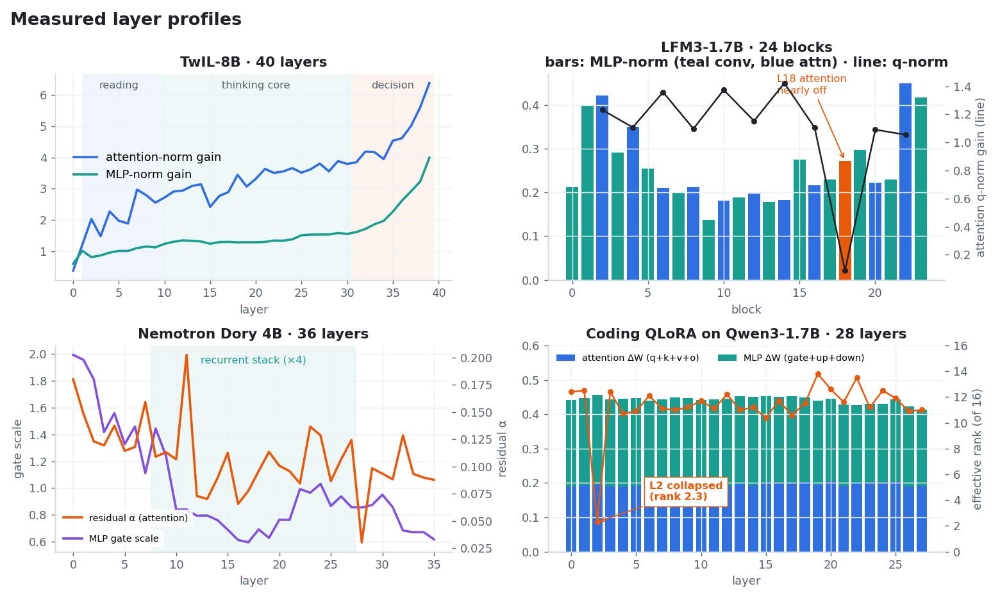

# 🧠 LocalModels Neural Reviews

**Layer-by-layer X-rays of the local LLMs on one 6 GB laptop.**

*No benchmarks, no vibes. Each review opens the model file and measures every layer.*

---

## 📚 Contents

1. [How each model was reviewed](#-how-each-model-was-reviewed)
2. [Skeletons: what each model looks like inside](#-skeletons-what-each-model-looks-like-inside)
3. [Measured layer profiles](#-measured-layer-profiles)
4. [All reviews](#-all-reviews)
5. [How to read a review](#-how-to-read-a-review)

---

## 🔬 How each model was reviewed

Every review follows the same steps, using only the model file.

| Step | What happens | Tool |
|---|---|---|
| **1. Open** | Read the GGUF / safetensors file and its metadata (architecture, width, heads, context). | `gguf.GGUFReader`, `safetensors` |
| **2. Group** | Sort every tensor into its stack (LLM, vision encoder, audio encoder, audio generator) and its block number. | regex on tensor names |
| **3. Dequantize** | Turn Q4/Q5/Q8 blocks back into float32 so numbers are comparable. | `gguf.quants.dequantize` |
| **4. Measure** | Compute one number per tensor (see table below). | numpy |
| **5. Compare** | Line layers up, find zones, outliers and switched-off parts. Compare models that share a skeleton. | drift metric |
| **6. Explain** | Turn the numbers into plain language: what each zone likely does, what's strong, and where edits are safe. | review |

### What gets measured

| Tensor type | Number | Why it matters |
|---|---|---|
| **Norm vectors** (attention / MLP norm) | mean \|gain\| | How loudly the model lets that layer speak. A gain near 0 means the layer is nearly switched off. |
| **Weight matrices** (q, k, v, o, gate, up, down) | RMS of the first 256 rows | How big the weights are. It also shows where quantization spent its bits. |
| **Learned scales** (Dory: `residual_alpha`, gate scales) | value | These replace norms in norm-free models. |
| **LoRA adapters** | ‖ΔW‖ for ΔW = B·A·(α/r), and effective rank | How much each module changed, and in how many directions. |
| **Related models** | drift = mean relative change of norm gains | 0 means the same LLM. Shows which fine-tune came from which. |

> [!NOTE]
> All numbers are **measured from the weights**. Zone labels like "reading" or "decision" are **informed interpretation** of those numbers. They were not proven by activation probing. Treat them as a map, not ground truth.

---

## 🦴 Skeletons: what each model looks like inside

In each diagram one bar is one layer, the bar height is the measured value, and the colour is the zone.

### TwIL-8B: dense 40-layer Granite

### Nemotron-Labs Dory 4B: looped and norm-free

### LFM3-1.7B: hybrid conv + attention

### LFM3 family: one brain, six bodies

### Coding QLoRA adapter on Qwen3-1.7B

---

## 📈 Measured layer profiles

| Model | Headline finding |
|---|---|
| **TwIL-8B** | Gains climb steadily with depth; the last 9 layers are the loudest, so the "decision" zone dominates. |
| **LFM3-1.7B** | Block 18's attention is nearly off (q-norm ≈ 0.09) in **all six** LFM3 models. It is the best pruning candidate. |
| **Dory 4B** | Layers 8–27 run **4 times**, so 4B params give 192 blocks of compute. Edit outside the loop. |
| **Coding QLoRA** | 52% of the change is in the MLP. Layer 2's `down_proj` collapsed to rank 2.3 of 16. |

---

## 📋 All reviews

| | Model | Base / type | Params | Quant | Review |
|---|---|---|---|---|---|
| 🟦 | **TwIL-8B** | IBM Granite 8B, dense, 40 layers | 8.79B | Q4_K_M | [read →](reviews/TwIL-8B.md) |
| 🟩 | **Nemotron-Labs Dory 4B** | looped, norm-free, 36 layers ×4 loop | 3.98B | Q5_K_M | [read →](reviews/Nemotron-Dory-4B.md) |
| 🟧 | **LFM3-1.7B** | LFM3 hybrid conv+attention, text | 1.73B | Q4_K_M | [read →](reviews/LFM3-1.7B.md) |
| 🟧 | **LFM3-VL-2B** | LFM3 + vision | 1.73B + 189M | Q4_K_M / Q8_0 | [read →](reviews/LFM3-VL-2B.md) |
| 🟧 | **LFM3-Audio-2B** | LFM3 + hearing + speech out | 1.73B + 285M | Q4_K_M | [read →](reviews/LFM3-Audio-2B.md) |
| 🟧 | **LFM3-Omni-2B** | LFM3 + vision + hearing + speech | 1.73B + 475M | Q4_K_M | [read →](reviews/LFM3-Omni-2B.md) |
| 🟧 | **d1-2B** | LFM3 non-causal judge + vision | 1.73B + 189M | Q4_K_M / Q8_0 | [read →](reviews/d1-2B.md) |
| 🟧 | **d1-Omni-2B** | LFM3 non-causal judge + vision + hearing | 1.73B + 305M | Q8_0 | [read →](reviews/d1-Omni-2B.md) |
| 🟪 | **Coding QLoRA adapter** | LoRA r16 on Qwen3-1.7B | 17.4M | fp32 | [read →](reviews/Coding-QLoRA-adapter.md) |

🔗 **Family overview:** [LFM3-family-comparison.md](reviews/LFM3-family-comparison.md) explains how the six LFM3 models share one LLM and which encoders are byte-identical.

---

## 🧭 How to read a review

Every review has the same sections:

1. **Summary**: what the model is, in two lines.
2. **The model in one picture**: its skeleton.
3. **What the layers do**: zones, the numbers behind them, and a table of every layer.
4. **What's strong / weak spots.**
5. **Surgical map**: where to put a fact edit, a steering vector or a LoRA, and which layers to leave alone.
6. **Verdict.**

---

**Test machine:** RTX 4050 6 GB · 16 GB RAM · Windows 11

*Reviews read the weights only. No training was done.*

