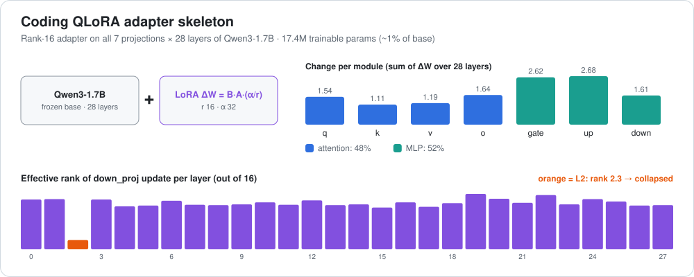

# Coding QLoRA adapter (Qwen3-1.7B): a look inside the layers

[← all reviews](../README.md)

*Source: `adapter_model.safetensors` (PEFT 0.21.2). Measured: Frobenius norm of ΔW = B·A·(α/r) per module, and effective rank (entropy of singular values) of `down_proj`.*

---

## 1. Summary

A **small coding fine-tune** for **Qwen/Qwen3-1.7B**: rank 16, alpha 32, dropout 0.05, on all 7 projections (q, k, v, o, gate, up, down) of all 28 layers. **17.4M trainable params** (~1% of the base), stored in fp32.

---

## 2. Shape

| Module | A | B | Note |
|---|---|---|---|
| q / o | 2048→16 | 16→2048 | |
| k / v | 2048→16 | 16→1024 | 8 key-value heads |
| gate / up | 2048→16 | 16→6144 | MLP in |
| down | 6144→16 | 16→2048 | MLP out |

---

## 3. What the layers do

> **Caveat:** numbers are measured from the weights. The "what it means" readings are informed interpretation, not proven by activation probing.

### Every layer

| L | q | k | v | o | gate | up | down | total ΔW | eff. rank (of 16) |
|---|---|---|---|---|---|---|---|---|---|
| 0 | 0.053 | 0.039 | 0.041 | 0.057 | 0.097 | 0.097 | 0.058 | 0.178 | 12.4 |
| 1 | 0.055 | 0.040 | 0.041 | 0.058 | 0.097 | 0.098 | 0.058 | 0.179 | 12.5 |
| 2 | 0.056 | 0.041 | 0.041 | 0.058 | 0.098 | 0.099 | 0.063 | 0.182 | **2.3** |
| 3 | 0.053 | 0.038 | 0.041 | 0.057 | 0.097 | 0.101 | 0.056 | 0.179 | 12.4 |
| 4 | 0.053 | 0.037 | 0.042 | 0.057 | 0.099 | 0.100 | 0.057 | 0.180 | 10.7 |
| 5 | 0.053 | 0.038 | 0.042 | 0.058 | 0.097 | 0.100 | 0.059 | 0.180 | 10.9 |
| 6 | 0.053 | 0.037 | 0.041 | 0.058 | 0.095 | 0.098 | 0.057 | 0.177 | 12.1 |
| 7 | 0.055 | 0.041 | 0.041 | 0.057 | 0.094 | 0.099 | 0.057 | 0.178 | 11.1 |
| 8 | 0.055 | 0.040 | 0.042 | 0.059 | 0.094 | 0.099 | 0.059 | 0.179 | 11.0 |
| 9 | 0.056 | 0.040 | 0.043 | 0.058 | 0.094 | 0.098 | 0.058 | 0.179 | 11.2 |
| 10 | 0.055 | 0.038 | 0.042 | 0.059 | 0.093 | 0.096 | 0.058 | 0.176 | 11.7 |
| 11 | 0.055 | 0.038 | 0.041 | 0.059 | 0.095 | 0.097 | 0.059 | 0.178 | 11.1 |
| 12 | 0.052 | 0.039 | 0.042 | 0.058 | 0.097 | 0.099 | 0.058 | 0.179 | 12.2 |
| 13 | 0.056 | 0.040 | 0.043 | 0.058 | 0.094 | 0.103 | 0.059 | 0.181 | 11.0 |
| 14 | 0.055 | 0.039 | 0.044 | 0.056 | 0.096 | 0.101 | 0.059 | 0.180 | 11.2 |
| 15 | 0.057 | 0.042 | 0.043 | 0.057 | 0.097 | 0.097 | 0.059 | 0.180 | 10.4 |
| 16 | 0.056 | 0.040 | 0.044 | 0.059 | 0.095 | 0.097 | 0.059 | 0.179 | 11.7 |
| 17 | 0.055 | 0.040 | 0.044 | 0.060 | 0.095 | 0.098 | 0.061 | 0.180 | 10.6 |
| 18 | 0.057 | 0.041 | 0.044 | 0.060 | 0.092 | 0.095 | 0.059 | 0.177 | 11.5 |
| 19 | 0.054 | 0.040 | 0.042 | 0.060 | 0.093 | 0.094 | 0.056 | 0.174 | 13.8 |
| 20 | 0.058 | 0.041 | 0.044 | 0.061 | 0.092 | 0.094 | 0.055 | 0.176 | 12.6 |
| 21 | 0.054 | 0.038 | 0.043 | 0.057 | 0.088 | 0.092 | 0.057 | 0.170 | 11.6 |
| 22 | 0.054 | 0.040 | 0.044 | 0.060 | 0.089 | 0.087 | 0.053 | 0.168 | 13.5 |
| 23 | 0.058 | 0.040 | 0.042 | 0.061 | 0.087 | 0.087 | 0.056 | 0.169 | 11.2 |
| 24 | 0.054 | 0.038 | 0.045 | 0.062 | 0.087 | 0.089 | 0.056 | 0.170 | 12.5 |
| 25 | 0.056 | 0.041 | 0.044 | 0.061 | 0.090 | 0.094 | 0.058 | 0.175 | 11.9 |
| 26 | 0.054 | 0.040 | 0.042 | 0.054 | 0.088 | 0.089 | 0.056 | 0.167 | 10.9 |
| 27 | 0.056 | 0.041 | 0.040 | 0.055 | 0.085 | 0.084 | 0.053 | 0.163 | 11.0 |

Per-module total (sum over 28 layers): q 1.54 · k 1.11 · v 1.19 · o 1.64 · **gate 2.62 · up 2.68** · down 1.61.

- **~52% of the change is in the MLP** (gate/up/down). The adapter mostly taught *knowledge and habits*, not new attention patterns.
- **Even across depth:** total ΔW is 0.163–0.182 in every layer. Highest at L2 (0.182) and L13 (0.181), gently fading over L21–27 to 0.163.
- **k_proj is smallest** (0.037–0.042): where to look barely changed.
- **⚠ L2 `down_proj` effective rank 2.3** (all other layers 10.4–13.8). That layer's MLP update collapsed to ~2 directions. Possible causes: a few dominant training examples, or a learning-rate spike. **Check it**: try the adapter with L2 down_proj zeroed and compare outputs.

---

## 4. What's strong

1. **Tiny and cheap**: 17M params, loads in seconds on top of the base.
2. **Full coverage**: all 7 modules × 28 layers, nothing skipped.
3. **Balanced**: no layer over-trained except the L2 anomaly.

## 5. Weak spots

1. **L2 rank collapse** (see above).
2. **fp32 storage** doubles the file size for no quality gain; bf16 would do.
3. **Uniform depth profile** suggests no layer targeting; a coding LoRA might do as well with only MLPs of L8–24.

---

## 6. Verdict

A **clean, standard coding LoRA** that mainly reshapes Qwen3-1.7B's MLP knowledge. One flaw to check: **layer 2's down-projection is nearly rank-2**.
