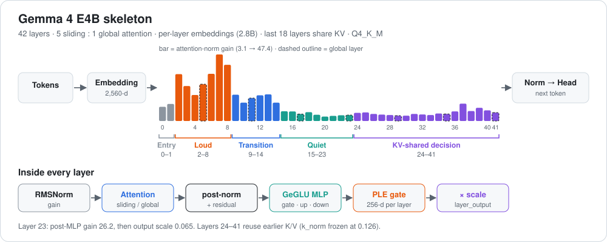

# Gemma 4 E4B-it: a look inside the layers



[← all reviews](../README.md)

*Source: the local file `gemma-4-E4B-it-Q4_K_M.gguf` (Unsloth, imatrix), read directly with the gguf library. Every number below is measured from the weights. No prompts were run and nothing was trained. The audio/vision encoder file was not downloaded, so only the language model is reviewed.*

---

## 1. Summary

Gemma 4 E4B has **7.52B parameters on disk but runs like a 4B model**. The trick is **per-layer embeddings (PLE)**: a 2.8B table that gives each of the 42 layers its own small token vector, looked up rather than computed. Attention mixes **5 sliding-window layers to 1 global layer**, and the **last 18 layers reuse the KV cache** of earlier layers.

Its gains are the most extreme in this collection: attention gain hits **47** at layer 7, and layer 23 has a post-MLP gain of **26** that is then scaled down to 0.065.

---

## 2. The model in one picture

```
 tokens ──► tokenizer (262,144 vocab)
              │
              ├──► embedding 2560-d (671M, Q4_K, tied)
              └──► per-layer embeddings 42 × 256-d (2.82B, Q5_K)
              │                                   │ one 256-d slice per layer
              ▼  × 42 layers                      ▼
 ┌──────────────────────────────────────────────────┐
 │ RMSNorm → attention (8q / 2kv) → post-norm       │
 │   sliding (window 512, head 256) × 5             │
 │   global  (full,       head 512) × 1             │
 │ RMSNorm → GeGLU MLP 2560 → 10240 → 2560 → norm   │
 │ + PLE gate: 2560 → 256 ⊙ slice → 2560            │
 │ × layer_output_scale                             │
 │ layers 24–41: reuse K/V from earlier layers      │
 └──────────────────────────────────────────────────┘
              │
              ▼
 output norm (gain 7.88) ──► tied head ──► softcap 30 ──► next token
```

| Item | Value |
|---|---|
| Architecture | `gemma4`, Gemma license |
| Parameters | 7.52B total; ≈4.0B compute core + 2.82B per-layer embeddings |
| Layers | 42 |
| Width / MLP | 2,560 / 10,240 |
| Attention | 8 query / 2 KV heads; head 256 (sliding) / 512 (global) |
| Global layers | 5, 11, 17, 23, 29, 35, 41 |
| KV sharing | last 18 layers (24–41) |
| Context | 131,072; sliding window 512 |
| Logit softcap | 30 |
| Quant | Q4_K_M, imatrix |

**Simple analogy:** each floor of a 42-floor building gets a small private notebook about the current word (PLE), so floors don't have to re-derive basics. Five floors in a row look only at the last 512 words; every sixth floor looks at everything. The top 18 floors don't take new notes on the text; they read the notes earlier floors already made.

---

## 3. What the layers do

> **Caveat:** zones come from where the measured numbers shift. They are interpretation of weights, not activation probing.

| Zone | Layers | Attention gain | MLP gain | What it means |
|---|---|---|---|---|
| **Entry** | 0–1 | 10–12 | 6.3, 35 | Low output scale (0.06, 0.16) and little PLE use: gentle start. |
| **Loud lexical** | 2–8 | **18–47** | **20–65** | Extremely loud. Peak attention at 7, peak MLP at 5. Likely word-level features. |
| **Transition** | 9–14 | 13–19 | 6.6–13.9 | Gains fall back. |
| **Quiet middle** | 15–23 | 3.1–7.0 | 0.5–2.9 | Calm work zone, ending in the **layer-23 spike**. |
| **KV-shared decision** | 24–41 | 3.8–12.4 | 0.5–2.9 | No own K/V; reads earlier memory. Output scales 0.8–0.9 (strong writes). |

Observations:

- **Layer 23 is the hinge.** It is the last global layer that still computes its own K/V. Its post-MLP gain is **26.2** and post-norm 8.2, yet `layer_output_scale` is **0.065**. It produces a very loud signal and then writes only a whisper of it. Layer 22 shows the same pattern, weaker (7.4 / 0.157).
- **KV sharing is visible in the weights.** In layers 24–41 the `k_norm` is a constant 0.126 (0.061 on global layers): untrained leftovers, because those layers never compute their own keys.
- **PLE use varies.** The PLE input gate is nearly closed at layers 0, 1, 8, 22, 23 (RMS 0.0014–0.0058) and open elsewhere (0.01–0.022).
- **Late layers write hardest.** `layer_output_scale` is 0.80–0.89 in layers 31–40, the highest in the stack; layer 41 drops to 0.445.
- `ffn_down` RMS dips to 0.013–0.015 at layers 19–23, then recovers to about 0.018.

### Every layer (all 42)

#### gemma4 · `blk` (42 blocks)

| L | type | M params | attn_n | q | k | v | o | q_n | k_n | ffn_n | f_gate | f_up | f_down | post_a | post_f | inp_gate | layer_output_scale | post_norm | proj |
|---|---|---|---|---|---|---|---|---|---|---|---|---|---|---|---|---|---|---|---|
| 0 | attn | 93.1 | 10.132 | 0.0276 | 0.0280 | 0.0273 | 0.0283 | 0.984 | 0.127 | 6.312 | 0.0256 | 0.0262 | 0.0212 | 2.616 | 6.157 | 0.0014 | 0.061 | 4.326 | 0.0716 |
| 1 | attn | 93.1 | 12.162 | 0.0295 | 0.0280 | 0.0296 | 0.0255 | 0.965 | 0.130 | 35.283 | 0.0256 | 0.0267 | 0.0213 | 2.227 | 0.911 | 0.0038 | 0.160 | 0.231 | 0.0749 |
| 2 | attn | 93.1 | 33.399 | 0.0240 | 0.0261 | 0.0246 | 0.0293 | 0.949 | 0.132 | 20.106 | 0.0275 | 0.0277 | 0.0206 | 0.284 | 0.508 | 0.0203 | 0.840 | 0.073 | 0.0738 |
| 3 | attn | 93.1 | 24.880 | 0.0270 | 0.0267 | 0.0267 | 0.0277 | 1.023 | 0.123 | 19.765 | 0.0260 | 0.0261 | 0.0206 | 0.407 | 0.734 | 0.0174 | 0.711 | 0.064 | 0.0779 |
| 4 | attn | 93.1 | 18.503 | 0.0275 | 0.0257 | 0.0265 | 0.0273 | 0.992 | 0.126 | 20.728 | 0.0275 | 0.0272 | 0.0204 | 0.502 | 0.961 | 0.0168 | 0.586 | 0.908 | 0.0788 |
| 5 | attn | 106.2 | 26.210 | 0.0262 | 0.0269 | 0.0264 | 0.0242 | 1.023 | 0.061 | 64.803 | 0.0269 | 0.0277 | 0.0211 | 0.816 | 1.038 | 0.0156 | 0.605 | 0.035 | 0.0746 |
| 6 | attn | 93.1 | 33.598 | 0.0271 | 0.0254 | 0.0283 | 0.0293 | 1.023 | 0.122 | 48.066 | 0.0277 | 0.0283 | 0.0206 | 1.243 | 0.906 | 0.0144 | 0.559 | 0.263 | 0.0835 |
| 7 | attn | 93.1 | 47.386 | 0.0278 | 0.0262 | 0.0284 | 0.0293 | 0.980 | 0.127 | 27.039 | 0.0277 | 0.0276 | 0.0212 | 0.438 | 0.975 | 0.0171 | 0.672 | 0.123 | 0.0881 |
| 8 | attn | 93.1 | 40.014 | 0.0266 | 0.0279 | 0.0288 | 0.0292 | 1.039 | 0.120 | 9.304 | 0.0276 | 0.0274 | 0.0195 | 0.524 | 2.470 | 0.0058 | 0.229 | 0.110 | 0.0811 |
| 9 | attn | 93.1 | 18.728 | 0.0260 | 0.0260 | 0.0256 | 0.0269 | 1.031 | 0.121 | 7.371 | 0.0264 | 0.0270 | 0.0204 | 0.377 | 1.386 | 0.0109 | 0.414 | 0.194 | 0.0674 |
| 10 | attn | 93.1 | 13.072 | 0.0273 | 0.0274 | 0.0263 | 0.0287 | 1.023 | 0.122 | 9.130 | 0.0275 | 0.0266 | 0.0196 | 0.509 | 1.016 | 0.0173 | 0.621 | 0.487 | 0.0763 |
| 11 | attn | 106.2 | 16.340 | 0.0253 | 0.0252 | 0.0245 | 0.0218 | 0.973 | 0.064 | 12.057 | 0.0257 | 0.0259 | 0.0202 | 0.708 | 1.320 | 0.0181 | 0.520 | 0.908 | 0.0623 |
| 12 | attn | 93.1 | 18.302 | 0.0214 | 0.0271 | 0.0236 | 0.0270 | 1.039 | 0.120 | 13.873 | 0.0279 | 0.0279 | 0.0198 | 0.611 | 0.914 | 0.0205 | 0.746 | 0.384 | 0.0687 |
| 13 | attn | 93.1 | 18.965 | 0.0253 | 0.0262 | 0.0258 | 0.0275 | 1.023 | 0.122 | 6.598 | 0.0268 | 0.0266 | 0.0201 | 0.434 | 1.225 | 0.0185 | 0.711 | 0.510 | 0.0729 |
| 14 | attn | 93.1 | 13.046 | 0.0237 | 0.0257 | 0.0239 | 0.0288 | 1.031 | 0.121 | 1.913 | 0.0257 | 0.0257 | 0.0192 | 0.575 | 1.599 | 0.0166 | 0.672 | 0.262 | 0.0738 |
| 15 | attn | 93.1 | 6.953 | 0.0235 | 0.0243 | 0.0240 | 0.0250 | 0.984 | 0.127 | 1.275 | 0.0253 | 0.0253 | 0.0176 | 0.918 | 1.950 | 0.0148 | 0.539 | 1.021 | 0.0619 |
| 16 | attn | 93.1 | 6.795 | 0.0244 | 0.0250 | 0.0241 | 0.0249 | 0.996 | 0.126 | 0.742 | 0.0235 | 0.0232 | 0.0165 | 0.768 | 1.664 | 0.0162 | 0.637 | 0.521 | 0.0630 |
| 17 | attn | 106.2 | 4.951 | 0.0231 | 0.0228 | 0.0224 | 0.0192 | 1.008 | 0.062 | 0.536 | 0.0233 | 0.0230 | 0.0159 | 1.310 | 2.736 | 0.0115 | 0.424 | 0.881 | 0.0589 |
| 18 | attn | 93.1 | 6.274 | 0.0251 | 0.0231 | 0.0231 | 0.0240 | 1.031 | 0.122 | 0.831 | 0.0224 | 0.0233 | 0.0148 | 0.917 | 2.067 | 0.0141 | 0.543 | 0.253 | 0.0795 |
| 19 | attn | 93.1 | 4.421 | 0.0205 | 0.0216 | 0.0218 | 0.0248 | 1.008 | 0.124 | 1.008 | 0.0218 | 0.0226 | 0.0142 | 0.879 | 2.197 | 0.0133 | 0.512 | 0.151 | 0.0813 |
| 20 | attn | 93.1 | 3.139 | 0.0204 | 0.0231 | 0.0245 | 0.0244 | 1.000 | 0.125 | 1.413 | 0.0209 | 0.0222 | 0.0141 | 1.009 | 2.628 | 0.0113 | 0.432 | 0.607 | 0.0657 |
| 21 | attn | 93.1 | 3.683 | 0.0193 | 0.0189 | 0.0209 | 0.0237 | 0.980 | 0.128 | 2.874 | 0.0227 | 0.0224 | 0.0141 | 0.834 | 2.553 | 0.0118 | 0.461 | 0.226 | 0.0941 |
| 22 | attn | 93.1 | 4.088 | 0.0238 | 0.0228 | 0.0197 | 0.0254 | 0.992 | 0.126 | 2.329 | 0.0210 | 0.0202 | 0.0134 | 0.829 | 7.371 | 0.0057 | 0.157 | 1.175 | 0.0692 |
| 23 | attn | 106.2 | 4.207 | 0.0239 | 0.0244 | 0.0239 | 0.0191 | 1.023 | 0.061 | 1.207 | 0.0234 | 0.0238 | 0.0146 | 4.962 | 26.160 | 0.0015 | 0.065 | 8.224 | 0.0686 |
| 24 | attn | 93.1 | 5.821 | 0.0227 | 0.0203 | 0.0203 | 0.0239 | 0.992 | 0.126 | 0.752 | 0.0236 | 0.0252 | 0.0164 | 1.242 | 2.820 | 0.0115 | 0.504 | 0.922 | 0.0627 |
| 25 | attn | 93.1 | 6.133 | 0.0226 | 0.0200 | 0.0200 | 0.0254 | 0.992 | 0.126 | 0.487 | 0.0239 | 0.0243 | 0.0161 | 0.752 | 1.554 | 0.0174 | 0.715 | 0.530 | 0.0645 |
| 26 | attn | 93.1 | 5.043 | 0.0215 | 0.0207 | 0.0207 | 0.0255 | 0.992 | 0.126 | 0.589 | 0.0223 | 0.0231 | 0.0161 | 0.652 | 1.553 | 0.0174 | 0.715 | 0.614 | 0.0637 |
| 27 | attn | 93.1 | 4.578 | 0.0251 | 0.0200 | 0.0200 | 0.0249 | 0.992 | 0.126 | 0.627 | 0.0228 | 0.0241 | 0.0155 | 0.680 | 1.704 | 0.0162 | 0.691 | 0.528 | 0.0676 |
| 28 | attn | 93.1 | 4.286 | 0.0248 | 0.0204 | 0.0204 | 0.0240 | 0.992 | 0.126 | 0.778 | 0.0231 | 0.0234 | 0.0152 | 0.721 | 1.993 | 0.0148 | 0.613 | 0.890 | 0.0687 |
| 29 | attn | 106.2 | 3.801 | 0.0235 | 0.0199 | 0.0199 | 0.0196 | 1.023 | 0.061 | 0.574 | 0.0236 | 0.0233 | 0.0152 | 0.972 | 2.773 | 0.0104 | 0.420 | 0.951 | 0.0817 |
| 30 | attn | 93.1 | 3.770 | 0.0213 | 0.0194 | 0.0194 | 0.0244 | 0.992 | 0.126 | 0.845 | 0.0231 | 0.0246 | 0.0170 | 0.735 | 1.548 | 0.0175 | 0.711 | 0.153 | 0.0866 |
| 31 | attn | 93.1 | 5.032 | 0.0227 | 0.0205 | 0.0205 | 0.0253 | 0.992 | 0.126 | 0.821 | 0.0237 | 0.0237 | 0.0171 | 0.626 | 1.151 | 0.0200 | 0.816 | 0.247 | 0.0781 |
| 32 | attn | 93.1 | 4.642 | 0.0232 | 0.0207 | 0.0207 | 0.0251 | 0.992 | 0.126 | 1.082 | 0.0259 | 0.0252 | 0.0171 | 0.481 | 1.072 | 0.0209 | 0.852 | 0.215 | 0.0789 |
| 33 | attn | 93.1 | 4.272 | 0.0253 | 0.0202 | 0.0202 | 0.0251 | 0.992 | 0.126 | 1.110 | 0.0241 | 0.0243 | 0.0186 | 0.639 | 1.132 | 0.0201 | 0.824 | 0.252 | 0.0751 |
| 34 | attn | 93.1 | 5.359 | 0.0234 | 0.0204 | 0.0204 | 0.0256 | 0.992 | 0.126 | 1.008 | 0.0253 | 0.0250 | 0.0180 | 0.433 | 1.169 | 0.0206 | 0.836 | 0.218 | 0.0791 |
| 35 | attn | 106.2 | 4.990 | 0.0238 | 0.0197 | 0.0197 | 0.0200 | 1.023 | 0.061 | 0.715 | 0.0247 | 0.0252 | 0.0176 | 0.621 | 1.103 | 0.0206 | 0.836 | 0.224 | 0.0727 |
| 36 | attn | 93.1 | 6.840 | 0.0238 | 0.0199 | 0.0199 | 0.0261 | 0.992 | 0.126 | 0.642 | 0.0246 | 0.0257 | 0.0179 | 0.619 | 0.945 | 0.0213 | 0.855 | 0.138 | 0.0779 |
| 37 | attn | 93.1 | 12.348 | 0.0231 | 0.0189 | 0.0189 | 0.0252 | 0.992 | 0.126 | 0.574 | 0.0241 | 0.0243 | 0.0185 | 0.429 | 0.841 | 0.0221 | 0.887 | 0.145 | 0.0799 |
| 38 | attn | 93.1 | 7.111 | 0.0208 | 0.0193 | 0.0193 | 0.0237 | 0.992 | 0.126 | 0.552 | 0.0231 | 0.0237 | 0.0188 | 0.372 | 0.868 | 0.0223 | 0.883 | 0.102 | 0.0736 |
| 39 | attn | 93.1 | 9.410 | 0.0231 | 0.0190 | 0.0190 | 0.0259 | 0.992 | 0.126 | 0.505 | 0.0254 | 0.0256 | 0.0187 | 0.394 | 1.015 | 0.0213 | 0.855 | 0.188 | 0.0715 |
| 40 | attn | 93.1 | 7.588 | 0.0235 | 0.0199 | 0.0199 | 0.0258 | 0.992 | 0.126 | 0.595 | 0.0225 | 0.0241 | 0.0186 | 0.506 | 1.215 | 0.0206 | 0.809 | 0.140 | 0.0758 |
| 41 | attn | 106.2 | 5.993 | 0.0222 | 0.0190 | 0.0190 | 0.0196 | 1.023 | 0.061 | 0.660 | 0.0243 | 0.0233 | 0.0155 | 0.499 | 1.454 | 0.0101 | 0.445 | 0.734 | 0.0664 |

### Where the compression spent its bits

- `attn_v` and `ffn_down`: half Q6_K, half Q4_K.
- Other matrices: Q4_K.
- Per-layer embedding table: Q5_K (2.8B params, the largest single tensor).
- PLE projection: BF16; per-layer PLE gates: F32.
- Main embedding: Q4_K.

---

## 4. What's strong

1. **4B compute, 7.5B knowledge.** PLE adds lookup capacity without adding work per token.
2. **Very small KV cache.** Sliding window on 5/6 of layers plus 18 layers of KV sharing.
3. **Big vocabulary** (262K) for many languages.
4. **Logit softcap** keeps the final scores stable.
5. Built as an any-to-any model (audio + vision encoders exist, not reviewed here).

## 5. Weak spots

1. **Large on disk.** 7.5B params means a bigger file than a true 4B model; PLE must still sit in RAM or VRAM.
2. **Extreme gains in layers 2–8** (up to 65) make the early stack fragile under heavy quantization or edits.
3. **Only 7 global layers**; long-range recall rests on them.
4. **Needs a recent runtime** that supports `gemma4`, PLE and KV sharing.

---

## 6. Surgical map: where to edit what

| Goal | Best place | Why |
|---|---|---|
| Fact edit (ROME-style) | MLP of layers 15–21 | Quiet middle, low gain, own K/V still computed. |
| Steering vector | Residual after layers 24–30 | Start of the decision zone, strong output scales. |
| LoRA for style / format | `attn_q` + MLP in 24–40 | Loudest writers; only q matters there. |
| Per-token tweaks | PLE table slice of one layer | A direct per-token, per-layer knob. |
| **Leave alone** | Layers 0–8, layer 23, `layer_output_scale` everywhere | Extreme gains; layer 23's 26 → 0.065 balance is delicate. |
| **No effect** | `attn_k` / `attn_v` in layers 24–41 | Those layers reuse earlier K/V; edits there do nothing. |

> To confirm a zone before editing, run a probe: log the residual norm after each layer and check that layer 23's write really is small.

---

## 7. Verdict

The most unusual design in this collection. Gemma 4 E4B hides a 2.8B lookup table behind a 4B compute core, shares memory across its top 18 layers and runs with extreme internal gains. It is efficient at run time and knowledgeable for its compute, but large on disk and touchy to edit. The KV-shared top half and the layer-23 hinge are the two facts any fine-tune must respect.
