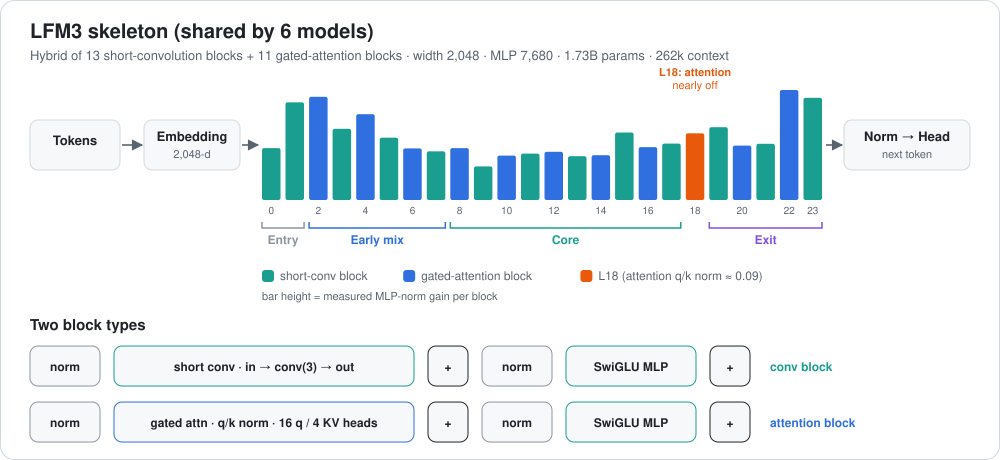

# LFM3-1.7B: a look inside the layers



[← all reviews](../README.md)

*Source: local GGUF files read with the `gguf` library. LLM file quant: Q6_K embeddings, 1,728,801,600 params.*

---

## 1. Summary

The **base text model** of the family. Every other LFM3 model in this lab reuses this exact 24-block skeleton. Context is **262,144 tokens**.

---

## 2. The LLM in one picture

```
 tokens (vocab 128,000) ─► EMBEDDING 2048-wide (tied with output head)
          │
 ┌──────── 24 BLOCKS, two kinds, interleaved ────────────────────────────┐
 │ SHORT-CONV block  (13 of them: L0,1,3,5,…,23)   64.0M params each     │
 │   norm ─► short convolution "look at the last few tokens" ─► post-norm│
 │   norm ─► MLP 7,680 neurons                              ─► post-norm│
 │ GATED-ATTENTION block (11 of them: L2,4,…,22)    57.7M params each    │
 │   norm ─► attention 16 query / 4 key-value heads, gated  ─► post-norm│
 │   norm ─► MLP 7,680 neurons                              ─► post-norm│
 └───────────────────────────────────────────────────────────────────────┘
          │  attention L4,8,12,16,20 = sliding window 256; others global
          ▼
 OUTPUT NORM ─► OUTPUT HEAD (same matrix as embedding) ─► next token
```

| Item | Value |
|---|---|
| LLM parameters | 1,728,801,600 (same skeleton in all six LFM3 models) |
| Blocks | 24 = 13 short-conv + 11 gated-attention |
| Width | 2,048 |
| MLP neurons | 7,680 per block, 184,320 total |
| Attention | 16 query heads, 4 key/value heads, head size 128, q/k norms, output gate |
| Sliding window | 256 tokens on attention L4, 8, 12, 16, 20; L2, 6, 10, 14, 18, 22 see everything |
| RoPE base | 1,000,000 (global) / 10,000 (window) |
| Norms | pre-norm **and** post-norm ("sandwich") around every mixer and MLP |
| Embedding | 128,000 tokens, tied with output head |

---

## 3. What the layers do

> **Caveat:** numbers are measured from the weights (norm = mean |gain|, matrix = RMS of the first 256 rows after de-quantizing). The "what it means" readings are informed interpretation, not proven by activation probing.

| Zone | Blocks | What the numbers show | Likely job |
|---|---|---|---|
| **Entry** | 0–1 | conv mixer is strongest here (conv RMS highest at L0); MLP gain high at L1 | turn raw tokens into local word/phrase features |
| **Early mix** | 2–7 | first global attention at L2; post-norms still small | first look across the whole context |
| **Core** | 8–17 | flattest stretch; MLP gain lowest at L9 (0.137) | steady meaning-building; best place for edits |
| **Dead-ish attention** | 18 | q/k norm only 0.087/0.091 vs ~1.0+ elsewhere | attention scores here are nearly flat, so L18 attends almost uniformly; its MLP still works |
| **Exit** | 19–23 | post-norms climb to their max; MLP gain peaks (whole model) at L22, L2, L23, L1 | commit to the answer and shape the next token |

Other measured patterns:
- **Conv blocks** pre-norm gain 0.142–0.200; **attention blocks** pre-norm only 0.041–0.083. Attention gets a quieter input than conv.
- **Post-MLP norm** grows from 0.026 at L0 to 0.164 at L23: late blocks write louder into the stream.
- **q-norm** across attention blocks: 1.23, 1.11, 1.36, 1.10, 1.37, 1.15, 1.42, 1.11, 0.09, 1.09, 1.06 (L2→L22).
- **Output norm** 1.928.

### Every LLM layer

`·` = tensor not present in that block type. Norms are gains; matrices are RMS.

#### lfm3 · `blk` (24 blocks)

| L | type | M params | attn_n | q | k | v | o | q_n | k_n | gate_a | ffn_n | f_gate | f_up | f_down | post_a | post_f | conv | conv_in | conv_out |
|---|---|---|---|---|---|---|---|---|---|---|---|---|---|---|---|---|---|---|---|
| 0 | conv | 64.0 | 0.193 | · | · | · | · | · | · | · | 0.212 | 0.0217 | 0.0194 | 0.0199 | 0.025 | 0.026 | 0.0461 | 0.0213 | 0.0227 |
| 1 | conv | 64.0 | 0.183 | · | · | · | · | · | · | · | 0.399 | 0.0240 | 0.0195 | 0.0200 | 0.023 | 0.026 | 0.0405 | 0.0214 | 0.0240 |
| 2 | attn | 57.7 | 0.054 | 0.0152 | 0.0172 | 0.0199 | 0.0202 | 1.232 | 1.179 | 0.0704 | 0.421 | 0.0251 | 0.0196 | 0.0191 | 0.014 | 0.020 | · | · | · |
| 3 | conv | 64.0 | 0.165 | · | · | · | · | · | · | · | 0.291 | 0.0228 | 0.0194 | 0.0196 | 0.027 | 0.021 | 0.0402 | 0.0211 | 0.0231 |
| 4 | attn | 57.7 | 0.067 | 0.0181 | 0.0184 | 0.0205 | 0.0192 | 1.107 | 1.062 | 0.0702 | 0.350 | 0.0235 | 0.0195 | 0.0191 | 0.016 | 0.021 | · | · | · |
| 5 | conv | 64.0 | 0.150 | · | · | · | · | · | · | · | 0.254 | 0.0221 | 0.0193 | 0.0190 | 0.037 | 0.024 | 0.0398 | 0.0209 | 0.0201 |
| 6 | attn | 57.7 | 0.070 | 0.0179 | 0.0167 | 0.0204 | 0.0202 | 1.359 | 1.312 | 0.0638 | 0.210 | 0.0212 | 0.0193 | 0.0190 | 0.022 | 0.023 | · | · | · |
| 7 | conv | 64.0 | 0.142 | · | · | · | · | · | · | · | 0.199 | 0.0217 | 0.0193 | 0.0188 | 0.053 | 0.025 | 0.0377 | 0.0208 | 0.0259 |
| 8 | attn | 57.7 | 0.065 | 0.0194 | 0.0174 | 0.0203 | 0.0201 | 1.098 | 1.067 | 0.0669 | 0.212 | 0.0216 | 0.0192 | 0.0188 | 0.024 | 0.025 | · | · | · |
| 9 | conv | 64.0 | 0.158 | · | · | · | · | · | · | · | 0.137 | 0.0202 | 0.0189 | 0.0186 | 0.046 | 0.028 | 0.0400 | 0.0206 | 0.0213 |
| 10 | attn | 57.7 | 0.079 | 0.0186 | 0.0171 | 0.0215 | 0.0198 | 1.374 | 1.353 | 0.0641 | 0.181 | 0.0211 | 0.0192 | 0.0188 | 0.037 | 0.033 | · | · | · |
| 11 | conv | 64.0 | 0.175 | · | · | · | · | · | · | · | 0.189 | 0.0207 | 0.0192 | 0.0187 | 0.045 | 0.036 | 0.0407 | 0.0208 | 0.0203 |
| 12 | attn | 57.7 | 0.079 | 0.0189 | 0.0179 | 0.0206 | 0.0198 | 1.153 | 1.111 | 0.0642 | 0.197 | 0.0210 | 0.0193 | 0.0188 | 0.043 | 0.041 | · | · | · |
| 13 | conv | 64.0 | 0.193 | · | · | · | · | · | · | · | 0.179 | 0.0211 | 0.0192 | 0.0190 | 0.049 | 0.049 | 0.0440 | 0.0211 | 0.0197 |
| 14 | attn | 57.7 | 0.078 | 0.0195 | 0.0171 | 0.0187 | 0.0191 | 1.423 | 1.392 | 0.0819 | 0.183 | 0.0212 | 0.0196 | 0.0190 | 0.071 | 0.065 | · | · | · |
| 15 | conv | 64.0 | 0.179 | · | · | · | · | · | · | · | 0.276 | 0.0216 | 0.0196 | 0.0192 | 0.058 | 0.058 | 0.0370 | 0.0210 | 0.0209 |
| 16 | attn | 57.7 | 0.083 | 0.0206 | 0.0172 | 0.0194 | 0.0187 | 1.105 | 1.076 | 0.0729 | 0.216 | 0.0211 | 0.0197 | 0.0193 | 0.052 | 0.063 | · | · | · |
| 17 | conv | 64.0 | 0.194 | · | · | · | · | · | · | · | 0.230 | 0.0214 | 0.0197 | 0.0193 | 0.065 | 0.071 | 0.0360 | 0.0210 | 0.0207 |
| 18 | attn | 57.7 | 0.041 | 0.0198 | 0.0086 | 0.0179 | 0.0177 | 0.087 | 0.091 | 0.0596 | 0.272 | 0.0217 | 0.0199 | 0.0193 | 0.026 | 0.076 | · | · | · |
| 19 | conv | 64.0 | 0.200 | · | · | · | · | · | · | · | 0.297 | 0.0219 | 0.0197 | 0.0193 | 0.077 | 0.089 | 0.0378 | 0.0212 | 0.0203 |
| 20 | attn | 57.7 | 0.068 | 0.0213 | 0.0180 | 0.0192 | 0.0196 | 1.091 | 1.067 | 0.0945 | 0.222 | 0.0213 | 0.0197 | 0.0194 | 0.087 | 0.096 | · | · | · |
| 21 | conv | 64.0 | 0.199 | · | · | · | · | · | · | · | 0.229 | 0.0213 | 0.0195 | 0.0193 | 0.100 | 0.118 | 0.0390 | 0.0212 | 0.0208 |
| 22 | attn | 57.7 | 0.051 | 0.0183 | 0.0155 | 0.0191 | 0.0193 | 1.055 | 0.986 | 0.0959 | 0.449 | 0.0229 | 0.0210 | 0.0198 | 0.162 | 0.130 | · | · | · |
| 23 | conv | 64.0 | 0.193 | · | · | · | · | · | · | · | 0.417 | 0.0227 | 0.0209 | 0.0190 | 0.121 | 0.164 | 0.0416 | 0.0216 | 0.0203 |

---

## 4. What's strong

1. **Hybrid design is cheap.** 13 of 24 blocks use a short convolution instead of attention, so the KV cache only grows for 11 blocks. Long context is affordable on 6 GB.
2. **Long context:** 262k tokens, with global attention every other attention block.
3. **Sandwich norms + q/k norms + attention gate:** a very stable design to fine-tune.
4. **Small and fast:** 1.73B params at Q4_K_M runs fully on the GPU.

## 5. Weak spots

1. **L18 attention is nearly switched off** (q/k gain ≈0.09). That is ~5% of the attention budget doing almost nothing.
2. **Small width (2,048)** limits how much knowledge fits; expect weaker facts than 7–8B models.
3. **Tied embedding:** input and output share one matrix, so vocabulary edits hit both ends.

---

## 6. Surgical map

| Goal | Best place | Why |
|---|---|---|
| Fact / habit edit (ROME-style) | **MLP of L8–17** | flattest, lowest-gain core; edits stay contained |
| Steering vector | **residual after L10–16** | middle of the stack, before the exit zone amplifies |
| LoRA | **attention q/v/o of L2–16 + MLP L8–17** | attention blocks are few (11), so this is cheap |
| Revive / prune | **L18 attention** | near-flat attention; candidate to prune or to re-train with a small LoRA |
| Leave alone | **L0–1 and L21–23** | entry builds token features; exit has the highest gains and drift |


---

## 7. Verdict

LFM3-1.7B is a **1.73B-param LFM3 hybrid** (13 conv + 11 attention blocks) that fits easily on a 6 GB GPU. Its layers follow the family plan: busy entry, quiet core, near-off L18 attention, loud exit. Edit in the core, protect the ends.
