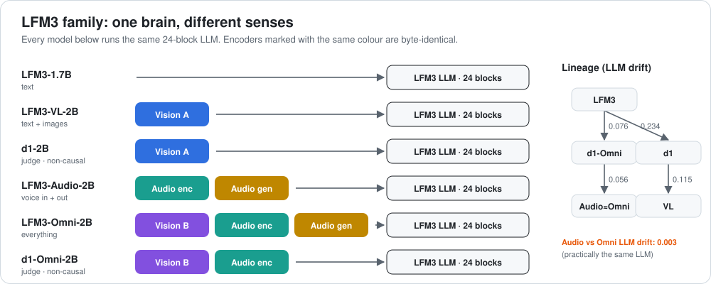

# LFM3-Audio-2B: a look inside the layers



[← all reviews](../README.md)

*Source: local GGUF files read with the `gguf` library. LLM file quant: Q6_K embeddings, 1,728,801,600 params.*

---

## 1. Summary

**Speech in, speech out.** The LFM3 LLM plus an audio encoder (hearing) and a two-stage audio generator (speaking). No vision.

---

## 2. The LLM in one picture

```
 tokens (vocab 128,000) ─► EMBEDDING 2048-wide (tied with output head)
          │
 ┌──────── 24 BLOCKS, two kinds, interleaved ────────────────────────────┐
 │ SHORT-CONV block  (13 of them: L0,1,3,5,…,23)   64.0M params each     │
 │   norm ─► short convolution "look at the last few tokens" ─► post-norm│
 │   norm ─► MLP 7,680 neurons                              ─► post-norm│
 │ GATED-ATTENTION block (11 of them: L2,4,…,22)    57.7M params each    │
 │   norm ─► attention 16 query / 4 key-value heads, gated  ─► post-norm│
 │   norm ─► MLP 7,680 neurons                              ─► post-norm│
 └───────────────────────────────────────────────────────────────────────┘
          │  attention L4,8,12,16,20 = sliding window 256; others global
          ▼
 OUTPUT NORM ─► OUTPUT HEAD (same matrix as embedding) ─► next token
```

| Item | Value |
|---|---|
| LLM parameters | 1,728,801,600 (same skeleton in all six LFM3 models) |
| Blocks | 24 = 13 short-conv + 11 gated-attention |
| Width | 2,048 |
| MLP neurons | 7,680 per block, 184,320 total |
| Attention | 16 query heads, 4 key/value heads, head size 128, q/k norms, output gate |
| Sliding window | 256 tokens on attention L4, 8, 12, 16, 20; L2, 6, 10, 14, 18, 22 see everything |
| RoPE base | 1,000,000 (global) / 10,000 (window) |
| Norms | pre-norm **and** post-norm ("sandwich") around every mixer and MLP |
| Embedding | 128,000 tokens, tied with output head |

---

## 3. What the layers do

> **Caveat:** numbers are measured from the weights (norm = mean |gain|, matrix = RMS of the first 256 rows after de-quantizing). The "what it means" readings are informed interpretation, not proven by activation probing.

| Zone | Blocks | What the numbers show | Likely job |
|---|---|---|---|
| **Entry** | 0–1 | conv mixer is strongest here (conv RMS highest at L0); MLP gain high at L1 | turn raw tokens into local word/phrase features |
| **Early mix** | 2–7 | first global attention at L2; post-norms still small | first look across the whole context |
| **Core** | 8–17 | flattest stretch; MLP gain lowest at L9 (0.139) | steady meaning-building; best place for edits |
| **Dead-ish attention** | 18 | q/k norm only 0.113/0.120 vs ~1.0+ elsewhere | attention scores here are nearly flat, so L18 attends almost uniformly; its MLP still works |
| **Exit** | 19–23 | post-norms climb to their max; MLP gain peaks (whole model) at L2, L1, L4, L22 | commit to the answer and shape the next token |

Other measured patterns:
- **Conv blocks** pre-norm gain 0.139–0.205; **attention blocks** pre-norm only 0.044–0.076. Attention gets a quieter input than conv.
- **Post-MLP norm** grows from 0.030 at L0 to 0.227 at L23: late blocks write louder into the stream.
- **q-norm** across attention blocks: 1.27, 1.18, 1.40, 1.15, 1.41, 1.28, 1.46, 1.19, 0.11, 1.26, 1.09 (L2→L22).
- **Output norm** 2.912.

### How far it moved from LFM3-1.7B

Mean relative change of every norm gain per block (0 = identical):

| L | 0 | 1 | 2 | 3 | 4 | 5 | 6 | 7 | 8 | 9 | 10 | 11 | 12 | 13 | 14 | 15 | 16 | 17 | 18 | 19 | 20 | 21 | 22 | 23 |
|---|---|---|---|---|---|---|---|---|---|---|---|---|---|---|---|---|---|---|---|---|---|---|---|---|
| drift | 0.12 | 0.21 | 0.17 | 0.21 | 0.18 | 0.16 | 0.13 | 0.15 | 0.13 | 0.11 | 0.13 | 0.13 | 0.15 | 0.09 | 0.09 | 0.11 | 0.09 | 0.10 | 0.15 | 0.11 | 0.08 | 0.08 | 0.09 | 0.23 |

Average **0.133**. Most changed: L23, L1, L3. Least changed: L21, L20, L22.

### Every LLM layer

`·` = tensor not present in that block type. Norms are gains; matrices are RMS.

#### audio · `blk` (24 blocks)

| L | type | M params | attn_n | q | k | v | o | q_n | k_n | gate_a | ffn_n | f_gate | f_up | f_down | post_a | post_f | conv | conv_in | conv_out |
|---|---|---|---|---|---|---|---|---|---|---|---|---|---|---|---|---|---|---|---|
| 0 | conv | 64.0 | 0.187 | · | · | · | · | · | · | · | 0.233 | 0.0217 | 0.0196 | 0.0204 | 0.029 | 0.030 | 0.0402 | 0.0211 | 0.0232 |
| 1 | conv | 64.0 | 0.193 | · | · | · | · | · | · | · | 0.469 | 0.0239 | 0.0195 | 0.0205 | 0.028 | 0.037 | 0.0367 | 0.0213 | 0.0244 |
| 2 | attn | 57.7 | 0.054 | 0.0161 | 0.0175 | 0.0197 | 0.0205 | 1.270 | 1.212 | 0.0696 | 0.482 | 0.0245 | 0.0198 | 0.0194 | 0.018 | 0.030 | · | · | · |
| 3 | conv | 64.0 | 0.168 | · | · | · | · | · | · | · | 0.321 | 0.0227 | 0.0196 | 0.0201 | 0.033 | 0.031 | 0.0363 | 0.0211 | 0.0231 |
| 4 | attn | 57.7 | 0.068 | 0.0186 | 0.0188 | 0.0202 | 0.0195 | 1.184 | 1.137 | 0.0702 | 0.400 | 0.0234 | 0.0197 | 0.0195 | 0.023 | 0.029 | · | · | · |
| 5 | conv | 64.0 | 0.150 | · | · | · | · | · | · | · | 0.281 | 0.0221 | 0.0196 | 0.0195 | 0.044 | 0.031 | 0.0360 | 0.0210 | 0.0205 |
| 6 | attn | 57.7 | 0.059 | 0.0188 | 0.0171 | 0.0198 | 0.0204 | 1.397 | 1.353 | 0.0690 | 0.231 | 0.0214 | 0.0196 | 0.0195 | 0.027 | 0.029 | · | · | · |
| 7 | conv | 64.0 | 0.139 | · | · | · | · | · | · | · | 0.210 | 0.0216 | 0.0195 | 0.0192 | 0.066 | 0.032 | 0.0346 | 0.0209 | 0.0267 |
| 8 | attn | 57.7 | 0.059 | 0.0199 | 0.0178 | 0.0197 | 0.0201 | 1.153 | 1.118 | 0.0728 | 0.237 | 0.0217 | 0.0195 | 0.0192 | 0.029 | 0.031 | · | · | · |
| 9 | conv | 64.0 | 0.158 | · | · | · | · | · | · | · | 0.139 | 0.0203 | 0.0192 | 0.0191 | 0.055 | 0.034 | 0.0361 | 0.0207 | 0.0219 |
| 10 | attn | 57.7 | 0.055 | 0.0195 | 0.0176 | 0.0190 | 0.0198 | 1.407 | 1.380 | 0.0686 | 0.196 | 0.0213 | 0.0195 | 0.0192 | 0.042 | 0.039 | · | · | · |
| 11 | conv | 64.0 | 0.172 | · | · | · | · | · | · | · | 0.195 | 0.0208 | 0.0194 | 0.0191 | 0.053 | 0.046 | 0.0360 | 0.0208 | 0.0209 |
| 12 | attn | 57.7 | 0.064 | 0.0192 | 0.0186 | 0.0195 | 0.0198 | 1.276 | 1.229 | 0.0713 | 0.210 | 0.0212 | 0.0196 | 0.0192 | 0.055 | 0.047 | · | · | · |
| 13 | conv | 64.0 | 0.184 | · | · | · | · | · | · | · | 0.181 | 0.0212 | 0.0194 | 0.0195 | 0.057 | 0.056 | 0.0374 | 0.0208 | 0.0200 |
| 14 | attn | 57.7 | 0.061 | 0.0203 | 0.0173 | 0.0174 | 0.0193 | 1.465 | 1.430 | 0.0863 | 0.185 | 0.0213 | 0.0197 | 0.0194 | 0.081 | 0.072 | · | · | · |
| 15 | conv | 64.0 | 0.181 | · | · | · | · | · | · | · | 0.304 | 0.0219 | 0.0197 | 0.0195 | 0.071 | 0.064 | 0.0336 | 0.0210 | 0.0217 |
| 16 | attn | 57.7 | 0.076 | 0.0212 | 0.0176 | 0.0187 | 0.0191 | 1.192 | 1.159 | 0.0745 | 0.225 | 0.0213 | 0.0198 | 0.0196 | 0.059 | 0.069 | · | · | · |
| 17 | conv | 64.0 | 0.194 | · | · | · | · | · | · | · | 0.238 | 0.0216 | 0.0199 | 0.0197 | 0.083 | 0.078 | 0.0321 | 0.0210 | 0.0216 |
| 18 | attn | 57.7 | 0.044 | 0.0205 | 0.0104 | 0.0185 | 0.0187 | 0.113 | 0.120 | 0.0538 | 0.283 | 0.0218 | 0.0199 | 0.0197 | 0.025 | 0.085 | · | · | · |
| 19 | conv | 64.0 | 0.198 | · | · | · | · | · | · | · | 0.305 | 0.0218 | 0.0196 | 0.0196 | 0.099 | 0.101 | 0.0333 | 0.0210 | 0.0207 |
| 20 | attn | 57.7 | 0.069 | 0.0223 | 0.0187 | 0.0194 | 0.0199 | 1.262 | 1.229 | 0.0986 | 0.220 | 0.0213 | 0.0197 | 0.0196 | 0.094 | 0.105 | · | · | · |
| 21 | conv | 64.0 | 0.202 | · | · | · | · | · | · | · | 0.228 | 0.0211 | 0.0196 | 0.0195 | 0.120 | 0.131 | 0.0338 | 0.0209 | 0.0211 |
| 22 | attn | 57.7 | 0.048 | 0.0193 | 0.0161 | 0.0188 | 0.0195 | 1.092 | 1.025 | 0.0935 | 0.370 | 0.0222 | 0.0195 | 0.0193 | 0.173 | 0.148 | · | · | · |
| 23 | conv | 64.0 | 0.205 | · | · | · | · | · | · | · | 0.333 | 0.0221 | 0.0193 | 0.0188 | 0.154 | 0.227 | 0.0385 | 0.0215 | 0.0206 |

---

## 4. The extra senses (projector file `mmproj`, 285.1M params)

### Audio encoder (`a.blk`, 17 blocks) — identical in Audio, Omni and d1-Omni

Sound → `a.conv1d` subsampling (256 channels) → `a.pre_encode.out` [4096→768] → 17 blocks of width 768:
- **10 conv blocks** (6.5M each): depthwise conv `c_dw` + two pointwise convs `c_pw1`/`c_pw2` (Conformer style);
- **7 attention blocks** (5.9M each) at L2, 5, 8, 11, 14, 15, 16. The last three are back-to-back: the top of the encoder is attention-heavy, to tie sounds into words.

Norms climb with depth: conv `ln1` 0.34→0.74, attention `ln1` 0.03→0.41, `ln2` 0.23→0.71. Then `a.post_ln` (0.108) → `mm.a.mlp` (768→2048→2048) into the LLM.

### Audio generator (speech out) — identical in Audio and Omni

Two stages turn the LLM's hidden state into sound:
1. **Code transformer** (`a.gen.code.blk`, 3 gated-attention blocks, 11.3M each, width 1,024). `proj_in` [2048→12288] feeds it; `out_embd` [2048×24,204] = **12 codebooks × 2,017 codes**. `head_norm` ≈1.05, plus a `mask_embd` (masked/parallel code prediction).
2. **Waveform decoder** (`a.gen.wav.tfm.blk`, 8 blocks, width 512: 5 conv at 4.6M, 3 attention at 4.2M). `in_proj` [256→512], `out_proj` [512→1282], quantizer codebook 4×2,016. Its post-MLP norm rises 0.58 → 1.50 at L7, and conv `c_dw` peaks at L5 (0.229): the last blocks do the loudest shaping of the waveform.

### Every projector layer

#### audio_proj · `a.blk` (17 blocks)

| L | type | M params | q | k | v | o | q_n | k_n | f_gate | f_up | f_down | c_dw | c_pw1 | c_pw2 | ln1 | ln2 |
|---|---|---|---|---|---|---|---|---|---|---|---|---|---|---|---|---|
| 0 | conv | 6.5 | · | · | · | · | · | · | 0.0290 | 0.0291 | 0.0288 | 0.0436 | 0.0308 | 0.0314 | 0.343 | 0.229 |
| 1 | conv | 6.5 | · | · | · | · | · | · | 0.0291 | 0.0284 | 0.0289 | 0.0385 | 0.0302 | 0.0298 | 0.402 | 0.206 |
| 2 | attn | 5.9 | 0.0284 | 0.0282 | 0.0282 | 0.0281 | 0.952 | 0.951 | 0.0290 | 0.0283 | 0.0287 | · | · | · | 0.033 | 0.231 |
| 3 | conv | 6.5 | · | · | · | · | · | · | 0.0292 | 0.0289 | 0.0292 | 0.0435 | 0.0309 | 0.0302 | 0.543 | 0.258 |
| 4 | conv | 6.5 | · | · | · | · | · | · | 0.0296 | 0.0289 | 0.0294 | 0.0430 | 0.0308 | 0.0305 | 0.555 | 0.257 |
| 5 | attn | 5.9 | 0.0295 | 0.0290 | 0.0284 | 0.0289 | 0.940 | 0.926 | 0.0296 | 0.0288 | 0.0291 | · | · | · | 0.073 | 0.263 |
| 6 | conv | 6.5 | · | · | · | · | · | · | 0.0296 | 0.0290 | 0.0293 | 0.0405 | 0.0308 | 0.0306 | 0.568 | 0.282 |
| 7 | conv | 6.5 | · | · | · | · | · | · | 0.0295 | 0.0289 | 0.0296 | 0.0415 | 0.0308 | 0.0308 | 0.559 | 0.287 |
| 8 | attn | 5.9 | 0.0292 | 0.0282 | 0.0309 | 0.0293 | 1.022 | 1.021 | 0.0296 | 0.0285 | 0.0290 | · | · | · | 0.107 | 0.299 |
| 9 | conv | 6.5 | · | · | · | · | · | · | 0.0300 | 0.0290 | 0.0295 | 0.0415 | 0.0308 | 0.0308 | 0.584 | 0.343 |
| 10 | conv | 6.5 | · | · | · | · | · | · | 0.0301 | 0.0293 | 0.0299 | 0.0435 | 0.0309 | 0.0313 | 0.639 | 0.383 |
| 11 | attn | 5.9 | 0.0294 | 0.0278 | 0.0300 | 0.0300 | 0.999 | 0.982 | 0.0299 | 0.0287 | 0.0291 | · | · | · | 0.193 | 0.410 |
| 12 | conv | 6.5 | · | · | · | · | · | · | 0.0308 | 0.0295 | 0.0299 | 0.0454 | 0.0313 | 0.0312 | 0.706 | 0.482 |
| 13 | conv | 6.5 | · | · | · | · | · | · | 0.0310 | 0.0298 | 0.0304 | 0.0465 | 0.0315 | 0.0312 | 0.742 | 0.561 |
| 14 | attn | 5.9 | 0.0284 | 0.0281 | 0.0313 | 0.0308 | 1.027 | 1.020 | 0.0311 | 0.0297 | 0.0301 | · | · | · | 0.242 | 0.634 |
| 15 | attn | 5.9 | 0.0292 | 0.0276 | 0.0308 | 0.0307 | 1.167 | 1.172 | 0.0311 | 0.0301 | 0.0305 | · | · | · | 0.314 | 0.672 |
| 16 | attn | 5.9 | 0.0305 | 0.0286 | 0.0314 | 0.0318 | 1.110 | 1.101 | 0.0321 | 0.0305 | 0.0300 | · | · | · | 0.414 | 0.707 |

#### audio_proj · `a.gen.code.blk` (3 blocks)

| L | type | M params | q | k | v | o | q_n | k_n | gate_a | f_gate | f_up | f_down | ln1 | ln2 |
|---|---|---|---|---|---|---|---|---|---|---|---|---|---|---|
| 0 | attn | 11.3 | 0.0289 | 0.0290 | 0.0265 | 0.0276 | 0.984 | 0.985 | 0.0214 | 0.0285 | 0.0267 | 0.0264 | 1.042 | 0.975 |
| 1 | attn | 11.3 | 0.0269 | 0.0224 | 0.0296 | 0.0266 | 0.959 | 0.962 | 0.0162 | 0.0263 | 0.0274 | 0.0269 | 1.103 | 1.103 |
| 2 | attn | 11.3 | 0.0269 | 0.0215 | 0.0344 | 0.0290 | 0.959 | 0.963 | 0.0226 | 0.0282 | 0.0320 | 0.0288 | 1.158 | 1.271 |

#### audio_proj · `a.gen.wav.tfm.blk` (8 blocks)

| L | type | M params | q | k | v | o | q_n | k_n | gate_a | f_gate | f_up | f_down | c_dw | c_pw1 | c_pw2 | post_a | post_f | ln1 | ln2 |
|---|---|---|---|---|---|---|---|---|---|---|---|---|---|---|---|---|---|---|---|
| 0 | conv | 4.6 | · | · | · | · | · | · | · | 0.0849 | 0.0871 | 0.0784 | 0.1629 | 0.0854 | 0.0797 | 0.409 | 0.580 | 0.674 | 0.614 |
| 1 | conv | 4.6 | · | · | · | · | · | · | · | 0.0868 | 0.0900 | 0.0841 | 0.1898 | 0.0937 | 0.0870 | 0.579 | 0.534 | 0.693 | 0.678 |
| 2 | attn | 4.2 | 0.0856 | 0.0847 | 0.0808 | 0.0818 | 1.017 | 1.008 | 0.0540 | 0.0924 | 0.0955 | 0.0836 | · | · | · | 0.528 | 0.580 | 0.712 | 0.740 |
| 3 | conv | 4.6 | · | · | · | · | · | · | · | 0.0922 | 0.0934 | 0.0851 | 0.2084 | 0.0950 | 0.0887 | 0.553 | 0.636 | 0.718 | 0.726 |
| 4 | attn | 4.2 | 0.0896 | 0.0887 | 0.0828 | 0.0815 | 1.184 | 1.176 | 0.0578 | 0.0928 | 0.0944 | 0.0863 | · | · | · | 0.631 | 0.731 | 0.719 | 0.727 |
| 5 | conv | 4.6 | · | · | · | · | · | · | · | 0.0936 | 0.0965 | 0.0863 | 0.2287 | 0.0968 | 0.0906 | 0.769 | 1.140 | 0.678 | 0.715 |
| 6 | attn | 4.2 | 0.0908 | 0.0881 | 0.0872 | 0.0767 | 0.883 | 0.872 | 0.0517 | 0.0926 | 0.0969 | 0.0824 | · | · | · | 0.849 | 1.445 | 0.680 | 0.806 |
| 7 | conv | 4.6 | · | · | · | · | · | · | · | 0.0844 | 0.0838 | 0.0699 | 0.1838 | 0.0899 | 0.0775 | 1.281 | 1.496 | 0.699 | 0.743 |

---

## 5. What's strong

1. **Full voice loop** in one model: listen → think → talk.
2. **Generator uses 12 codebooks** with a masked-code head, so it can predict codes in parallel (fast speech).
3. **LLM is shared bit-for-bit in spirit with Omni** (drift 0.003): the same voice brain.

## 6. Weak spots

1. **Entry (L1–5) and exit (L23) moved most** from the base (~0.2): the model re-learned how to read audio tokens and how to emit speech. Text-only skills may be weaker than LFM3-1.7B.
2. **Q4_K_M on a generator** can add audio artifacts; the waveform stage is small (width 512).
3. **L18 attention still near-off** (q/k ≈0.11).

---

## 7. Surgical map

| Goal | Best place | Why |
|---|---|---|
| Fact / habit edit (ROME-style) | **MLP of L8–17** | flattest, lowest-gain core; edits stay contained |
| Steering vector | **residual after L10–16** | middle of the stack, before the exit zone amplifies |
| LoRA | **attention q/v/o of L2–16 + MLP L8–17** | attention blocks are few (11), so this is cheap |
| Revive / prune | **L18 attention** | near-flat attention; candidate to prune or to re-train with a small LoRA |
| Leave alone | **L0–1 and L21–23** | entry builds token features; exit has the highest gains and drift |
| Projector | **adapter (`mm.*`) only** | the encoders are shared with sibling models; tune the adapter, not the tower |

---

## 8. Verdict

LFM3-Audio-2B is a **1.73B-param LFM3 hybrid** (13 conv + 11 attention blocks) that fits easily on a 6 GB GPU. Its layers follow the family plan: busy entry, quiet core, near-off L18 attention, loud exit. Edit in the core, protect the ends.
