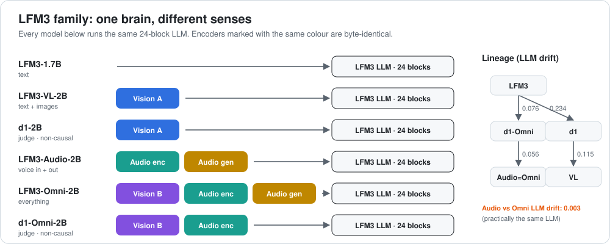

# LFM3 family: how the six models relate



[← all reviews](../README.md)

Six local models share **one 24-block LLM skeleton** (13 short-conv + 11 gated-attention blocks, width 2,048, 1.73B params). They differ in training and in the "senses" bolted on.

## Lineage (LLM drift = mean relative change of norm gains; 0 = identical)

| | LFM3 | d1 | d1-Omni | Audio | Omni | VL |
|---|---|---|---|---|---|---|
| **LFM3-1.7B** | – | 0.234 | 0.076 | 0.114 | 0.114 | 0.382 |
| **d1-2B** | | – | 0.187 | | | 0.115 |
| **d1-Omni-2B** | | | – | 0.056 | 0.056 | |
| **LFM3-Audio-2B** | | | | – | **0.003** | 0.487 |

```
 LFM3-1.7B ──► d1-Omni-2B ──► LFM3-Audio-2B ≈ LFM3-Omni-2B   (one line)
     ╲
      ╲……► d1-2B ──── LFM3-VL-2B                              (other line)
```

**Audio and Omni have practically the same LLM** (0.003). d1-Omni sits between the base and them. d1 and VL form a separate pair.

## Shared parts

| Part | Used by | Notes |
|---|---|---|
| Vision encoder A (small weights, adapter norm 0.45) | VL, d1 | identical |
| Vision encoder B (larger weights, adapter norm 1.0) | Omni, d1-Omni | identical |
| Audio encoder (17 blocks) | Audio, Omni, d1-Omni | identical |
| Audio generator (code 3 + wave 8 blocks) | Audio, Omni | identical |

## Common traits

| Trait | lfm3 | d1 | d1omni | audio | omni | vl |
|---|---|---|---|---|---|---|
| L18 attention q-norm (≈1 is normal) | 0.087 | 0.069 | 0.101 | 0.113 | 0.113 | 0.061 |
| Output norm | 1.928 | 2.389 | 2.71 | 2.912 | 2.904 | 2.587 |
| Causal | yes | **no** | **no** | yes | yes | yes |
| Quant | Q4_K_M | Q4_K_M | **Q8_0** | Q4_K_M | Q4_K_M | Q4_K_M |
| Projector | – | 189M | 305M | 285M | 475M | 189M |

- **L18 attention is nearly off in every model.** It was already quiet in the base and no fine-tune revived it. It is the best candidate for pruning.
- **Output norm grows with every derivative**: fine-tunes made the final layer louder.

## Which one to use

| Need | Pick |
|---|---|
| Plain text, longest context | LFM3-1.7B |
| Images → text | LFM3-VL-2B |
| Voice chat | LFM3-Audio-2B |
| Everything | LFM3-Omni-2B |
| Judge / score / choose | d1-2B (text+image) or d1-Omni-2B (+audio) |

Per-model reviews with every layer: see the other files in this folder.
