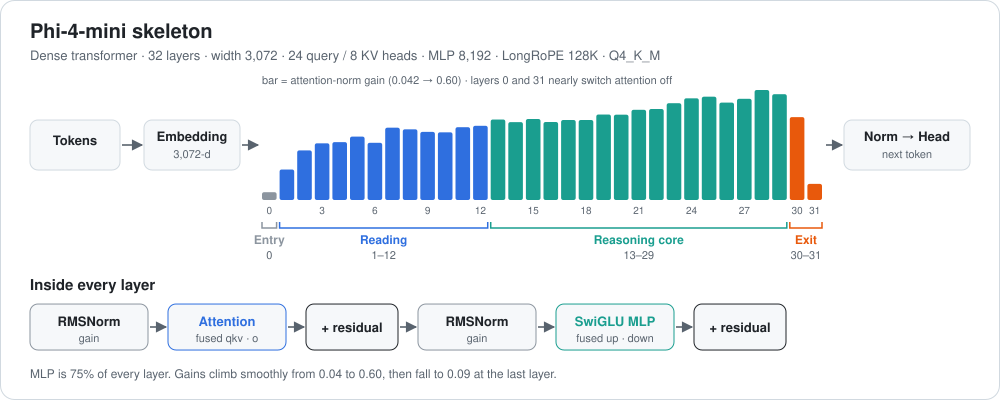

# Phi-4-mini-instruct: a look inside the layers



[← all reviews](../README.md)

*Source: the local file `microsoft_Phi-4-mini-instruct-Q4_K_M.gguf` (bartowski, imatrix), read directly with the gguf library. Every number below is measured from the weights. No prompts were run and nothing was trained.*

---

## 1. Summary

Phi-4-mini is a plain **dense transformer**: 32 identical layers, 3.84B parameters, MIT license. Three quarters of every layer is MLP. Its weights show something unusual: the **first and last layers almost switch attention off**, and gains climb slowly and steadily through the rest.

---

## 2. The model in one picture

```
 tokens ──► tokenizer (gpt-4o style, 200,064 vocab)
              │
              ▼
 ┌──────────────────────────────────────────┐
 │ embedding 3072-d  (615M, Q6_K, tied)     │
 └──────────────────────────────────────────┘
              │
              ▼  × 32 layers
 ┌──────────────────────────────────────────┐
 │ RMSNorm                                  │
 │ attention 24q / 8kv, fused qkv           │   25.2M  (25%)
 │   partial RoPE: 96 of 128 dims, LongRoPE │
 │ RMSNorm                                  │
 │ SwiGLU MLP 3072 → 8192 → 3072 (fused up) │   75.5M  (75%)
 └──────────────────────────────────────────┘
              │
              ▼
 output norm (gain 0.95) ──► tied head ──► next token
```

| Item | Value |
|---|---|
| Architecture | `phi3` (Phi-4-mini), MIT |
| Parameters | 3.84B |
| Layers | 32 |
| Width / MLP | 3,072 / 8,192 |
| Attention | 24 query / 8 KV heads, head dim 128 |
| Positional | partial RoPE (96 dims), LongRoPE short/long factors |
| Context | 131,072 (trained at 4,096, stretched) |
| Quant | Q4_K_M |

**Simple analogy:** a long hallway of 32 identical rooms. The doors of the first and the last room are almost shut to the rest of the text (attention off); those rooms just work on the word in hand. In the middle, each room opens its door a little wider than the one before.

---

## 3. What the layers do

> **Caveat:** zones come from where the measured numbers shift. They are interpretation of weights, not activation probing.

| Zone | Layers | Attention gain | MLP gain | What it means |
|---|---|---|---|---|
| **Entry** | 0 | **0.042** | 0.14 | Attention nearly off. The layer mostly re-shapes the raw token embedding. |
| **Reading** | 1–12 | 0.17 → 0.40 | 0.17 → 0.33 | Attention wakes up; layers gather nearby context. |
| **Reasoning core** | 13–29 | 0.44 → 0.60 | 0.33 → 0.46 | Slow, steady climb. Peak attention at layer 28. |
| **Exit** | 30–31 | 0.45, **0.088** | 0.44, 0.235 | Attention fades out again. Layer 31 is MLP-only output shaping. |

Observations:

- **Bookend layers.** Layers 0 and 31 both mute attention (gain 0.04 and 0.09, vs 0.4–0.6 in the middle). They act like per-token adapters between the embedding and the stack.
- **Layer 31 is special in its matrices too:** highest `ffn_up` RMS (0.0435), lowest `ffn_down` (0.0238), lowest `attn_output` (0.0196). It reads widely from the residual and writes back gently.
- **No sudden jumps.** Unlike TwIL or Gemma, gains rise smoothly; there is no single "loud" layer. That makes the model predictable to edit.
- **Early qkv alternates** between about 0.024 and 0.04 RMS layer by layer, a hint that early layers pair up into wide and narrow lookups.
- `ffn_down` is flat at about 0.033 across all layers.

### Every layer (all 32)

#### phi4 · `blk` (32 blocks)

| L | type | M params | attn_n | o | ffn_n | f_up | f_down | attn_qkv |
|---|---|---|---|---|---|---|---|---|
| 0 | ffn | 100.7 | 0.042 | 0.0218 | 0.140 | 0.0327 | 0.0324 | 0.0233 |
| 1 | ffn | 100.7 | 0.166 | 0.0248 | 0.160 | 0.0331 | 0.0327 | 0.0393 |
| 2 | ffn | 100.7 | 0.271 | 0.0253 | 0.185 | 0.0335 | 0.0326 | 0.0256 |
| 3 | ffn | 100.7 | 0.309 | 0.0245 | 0.212 | 0.0336 | 0.0323 | 0.0386 |
| 4 | ffn | 100.7 | 0.316 | 0.0272 | 0.218 | 0.0339 | 0.0319 | 0.0389 |
| 5 | ffn | 100.7 | 0.346 | 0.0253 | 0.232 | 0.0346 | 0.0316 | 0.0237 |
| 6 | ffn | 100.7 | 0.312 | 0.0266 | 0.237 | 0.0344 | 0.0318 | 0.0408 |
| 7 | ffn | 100.7 | 0.394 | 0.0248 | 0.241 | 0.0332 | 0.0319 | 0.0379 |
| 8 | ffn | 100.7 | 0.386 | 0.0264 | 0.249 | 0.0323 | 0.0321 | 0.0370 |
| 9 | ffn | 100.7 | 0.372 | 0.0275 | 0.253 | 0.0322 | 0.0322 | 0.0397 |
| 10 | ffn | 100.7 | 0.370 | 0.0280 | 0.257 | 0.0322 | 0.0322 | 0.0343 |
| 11 | ffn | 100.7 | 0.397 | 0.0275 | 0.265 | 0.0319 | 0.0324 | 0.0393 |
| 12 | ffn | 100.7 | 0.405 | 0.0284 | 0.260 | 0.0311 | 0.0326 | 0.0373 |
| 13 | ffn | 100.7 | 0.439 | 0.0270 | 0.273 | 0.0318 | 0.0330 | 0.0342 |
| 14 | ffn | 100.7 | 0.425 | 0.0280 | 0.282 | 0.0314 | 0.0330 | 0.0398 |
| 15 | ffn | 100.7 | 0.442 | 0.0274 | 0.292 | 0.0315 | 0.0329 | 0.0352 |
| 16 | ffn | 100.7 | 0.426 | 0.0285 | 0.296 | 0.0318 | 0.0329 | 0.0369 |
| 17 | ffn | 100.7 | 0.437 | 0.0287 | 0.302 | 0.0316 | 0.0329 | 0.0360 |
| 18 | ffn | 100.7 | 0.437 | 0.0294 | 0.317 | 0.0312 | 0.0329 | 0.0323 |
| 19 | ffn | 100.7 | 0.467 | 0.0304 | 0.325 | 0.0312 | 0.0328 | 0.0361 |
| 20 | ffn | 100.7 | 0.466 | 0.0303 | 0.348 | 0.0323 | 0.0331 | 0.0321 |
| 21 | ffn | 100.7 | 0.492 | 0.0301 | 0.359 | 0.0316 | 0.0333 | 0.0355 |
| 22 | ffn | 100.7 | 0.496 | 0.0319 | 0.375 | 0.0321 | 0.0335 | 0.0318 |
| 23 | ffn | 100.7 | 0.528 | 0.0319 | 0.389 | 0.0326 | 0.0338 | 0.0335 |
| 24 | ffn | 100.7 | 0.555 | 0.0322 | 0.400 | 0.0326 | 0.0341 | 0.0320 |
| 25 | ffn | 100.7 | 0.564 | 0.0342 | 0.419 | 0.0319 | 0.0340 | 0.0314 |
| 26 | ffn | 100.7 | 0.532 | 0.0330 | 0.434 | 0.0325 | 0.0339 | 0.0339 |
| 27 | ffn | 100.7 | 0.552 | 0.0327 | 0.447 | 0.0317 | 0.0338 | 0.0305 |
| 28 | ffn | 100.7 | 0.600 | 0.0352 | 0.460 | 0.0320 | 0.0331 | 0.0318 |
| 29 | ffn | 100.7 | 0.577 | 0.0340 | 0.459 | 0.0335 | 0.0319 | 0.0299 |
| 30 | ffn | 100.7 | 0.452 | 0.0331 | 0.438 | 0.0336 | 0.0286 | 0.0320 |
| 31 | ffn | 100.7 | 0.088 | 0.0196 | 0.235 | 0.0435 | 0.0238 | 0.0288 |

### Where the compression spent its bits

- `attn_qkv`: **Q5_K** in every layer.
- `ffn_down`: half Q6_K, half Q4_K.
- `attn_output` and `ffn_up`: Q4_K.
- Embedding: Q6_K (tied with the output head, so it matters twice).

---

## 4. What's strong

1. **Simple and predictable.** Plain dense layers, smooth gain curve, no oddities to work around.
2. **Big vocabulary** (200K) for its size, good for code and many languages.
3. **MLP-heavy** (75% of each layer), which suits stored knowledge and reasoning patterns.
4. **Grouped-query attention** (8 KV heads) keeps the KV cache small.
5. **MIT license.**

## 5. Weak spots

1. **Stretched context.** Trained at 4K and extended to 128K with LongRoPE; quality far out is likely lower than the headline number.
2. **Embedding is 16% of all params.** The large vocab costs space that a 3.8B model could use for layers.
3. **Two near-idle attention blocks** (layers 0 and 31) spend about 50M params on attention that barely runs.
4. Plain full attention everywhere: long context costs more memory than Qwen3.5 or Gemma 4.

---

## 6. Surgical map: where to edit what

| Goal | Best place | Why |
|---|---|---|
| Fact edit (ROME-style) | MLP of layers 8–18 | Middle of the stack, moderate gain, smooth neighbours. |
| Steering vector | Residual after layers 16–22 | Core of the reasoning zone; gains steady so effects spread evenly. |
| LoRA for style / format | `attn_qkv` + `ffn_up` in 20–29 | Loudest layers before the exit. |
| Pruning candidate | Attention of layers 0 and 31 | Gain under 0.09; test removing them first. |
| **Leave alone** | Layers 0, 30, 31 MLPs; LongRoPE factors | They bridge the embedding / head; changing RoPE factors breaks long context. |

> To confirm a zone before editing, run a probe: log the residual norm per layer and the attention entropy at layers 0 and 31.

---

## 7. Verdict

A clean, textbook dense model. Phi-4-mini has no tricks inside: 32 even layers whose gains rise smoothly, with attention almost off at both ends. That makes it the easiest model here to understand and to edit. It trades efficiency features (hybrid attention, KV sharing) for simplicity, so it's the best base in this collection for fine-tuning experiments.
