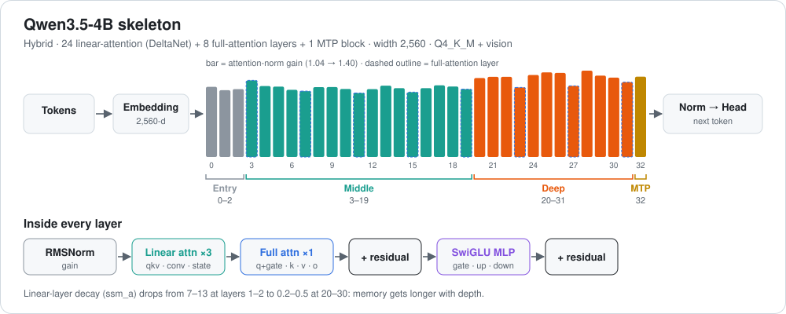

# Qwen3.5-4B 3D-Coder: a look inside the layers



[← all reviews](../README.md)

*Source: the fp16 safetensors of `ccore/Qwen3.5-4B-3D-Coder`, read directly with safetensors + PyTorch. Every number below is measured from the weights. No prompts were run and nothing was trained. Zones and "features" come from weights only, not from activation probing.*

---

## 1. Summary

This is a 3D / Three.js coding fine-tune of [Qwen3.5-4B](Qwen3.5-4B.md). The skeleton is the same: 32 layers, hybrid Gated DeltaNet + full attention, tied embeddings, one MTP layer. So this review skips what the base review already covers and goes deeper on the MLPs: **where each layer writes, and which layers work together.**

Three findings stand out:

1. **One shared direction dominates every MLP.** It sits 98.5% on hidden dim 0. It is the attention-sink / massive-activation channel, not a behaviour. Any "top singular vector" edit will hit it first. Remove it before looking for anything else.
2. **After removing it, the middle layers L13–L17 write the strongest layer-specific directions**, and they come in linked pairs (L13–14, L15–16, L16–17).
3. **Two late layers can be read through the vocabulary.** L27 is a digit feature ("8"). L31 shapes code statement endings (`;`, `};`, `]`).

---

## 2. The model in one picture

```
tokens ─► embed (tied) ─► L0-2 entry ─► L3-19 middle ─► L20-31 deep ─► norm ─► unembed
                                         │                  │
                         L13-17 strongest writers     L27 digit feature
                         L15↔L16↔L17 linked chain     L31 code-ending feature
                         L19 last full-attn before deep zone
   every MLP also writes a shared sink channel on hidden dim 0 (do not touch)
```

| Item | Value |
|---|---|
| Base | Qwen3.5-4B (same architecture, fine-tuned for 3D / Three.js code) |
| Layers | 32 text + 1 MTP |
| Hidden / MLP | 2560 / 9216 |
| Vocab | 248,320 (embeddings tied to output) |
| Full attention | L3, 7, 11, 15, 19, 23, 27, 31 |
| Linear attention | Gated DeltaNet on the other 24 layers |
| Norms | zero-centred (effective gain is 1 + w) |
| Precision read | fp16 |

---

## 3. What the layers do

> **Caveat:** these roles are read from weights. They tell you *where* a layer writes, not *when* it fires. Use them to narrow a search, then confirm with activations.

### Zones

| Zone | Layers | Evidence |
|---|---|---|
| Entry | 0–2 | DeltaNet decay `A` is 7–13: very short memory |
| Middle | 3–19 | strongest layer-specific MLP writers (L13–17); vocabulary readout is noise |
| Deep | 20–31 | `post_attention_layernorm` jumps 0.10 → 0.15 at L20 and climbs to 0.42 by L29; `A` drops to 0.2–0.47 (long memory) |
| MTP | 32 | draft head, not on the main path |

### The shared sink direction

- Eigen-decompose Σ W·Wᵀ over all 32 `down_proj` weights. The top direction holds 0.29% of the total MLP write energy, but layers line up on it with \|cos\| up to 0.92.
- It is 98.5% one coordinate: **hidden dim 0**.
- Its vocabulary readout is junk (`il`, `ing`, `usr` …). It has no meaning as a token; it is a scale channel that attention uses as a sink.

### Layer-specific write strength (shared direction removed)

| Layer | s0 | s0/s1 | Note |
|---|---|---|---|
| L8 | 1.39 | | start of the climb |
| L9 | 1.72 | | |
| L11 | 1.94 | | full attention |
| L13 | 2.20 | | linked with L14 |
| L14 | 2.10 | 1.20 | |
| **L15** | **2.32** | | **strongest middle writer**, full attention, linked with L16 |
| L16 | 2.18 | | links to both L15 and L17 |
| L17 | 2.24 | | |
| L18 | 1.63 | | dip |
| **L19** | 1.92 | **1.20** | most one-directional middle layer; peak `q_norm` (0.64); last full attention before the deep zone |
| L29 | 1.98 | | |
| L30 | 1.88 | | |
| L31 | 2.28 | 1.24 | output shaping |

### Linked layers

Pairs whose top two layer-specific directions overlap (\|cos\| > 0.4):

| Pair | \|cos\| |
|---|---|
| L13–L14 | 0.50 |
| **L15–L16** | **0.49** |
| L16–L17 | 0.48 |
| L20–L21 | 0.40 |

L15 → L16 → L17 act as a chain. An edit should cover the pair, not one layer.

### Vocabulary readout

- **L8–L20:** the promoted tokens are mixed-language noise. That is normal for middle layers.
- **L27:** promotes `8` / `eight` / `八` / `８`, suppresses `A` / `-A` / `.A` / `*A`. A digit feature.
- **L31:** suppresses code terminators: `";` `` `: `` `)` ` ]: ` `".` `` `; `` `};` `]`. It shapes how statements end.

### Other checks

- No outlier neurons: max column norm / median is 1.1–1.8 in every layer.
- `q_norm` peaks at L19 (0.64).

---

## 4. What's strong

- A clean, balanced MLP stack: no overloaded neurons anywhere.
- A clear middle zone with strong, structured writers (L13–17).
- A readable output stage: L31 carries a code-specific feature, which fits a coding fine-tune.

## 5. Weak spots

- The sink channel on dim 0 is shared by every layer. Careless edits or aggressive quantisation of dim 0 can break the whole model.
- The middle layers can't be read through the vocabulary, so behaviour directions there must come from activations.
- If generations fail to close code blocks, L31 is the first place to *measure* (not edit).

---

## 6. Surgical map

| Goal | Best place | Why |
|---|---|---|
| Remove a failure direction (loops, truncation, broken code) | `layers.15.mlp.down_proj` + `layers.16.mlp.down_proj` | strongest middle writer and its linked partner; same slot as the 0.8B blog edit at L15 |
| Second target | `layers.19.mlp.down_proj` | most one-directional middle layer, last full attention before the deep zone; matches the blog's L19 |
| Only if probing peaks there | L17, L13–14 `down_proj` | linked writers |
| Steering vector | residual after L19 | zone boundary |
| **Leave alone** | L0–2, `A_log` / `dt_bias` / `conv1d`, every norm, embeddings (tied), MTP, vision tower, **hidden dim 0**, **L27**, **L31** | global breakage or output-shaping features |

Recommended edit size: top 64 neurons per target layer, `W[:,j] -= α·d(dᵀW[:,j])` with α = 0.5–1.0. Three layers ≈ 0.49M weights (0.012% of the model). Project dim 0 and the shared direction out of `d` first.

---

## 7. Verdict

Same skeleton as Qwen3.5-4B, with a sharper picture of the MLPs. The weights point to **L15+16 and L19** as the surgery targets, and say clearly what not to touch: the dim-0 sink, L27 and L31. The final layer choice still needs an activation probe on real good vs bad outputs.

**Update:** a behaviour test (section 8) found the failures come from verbosity, not looping, and a prompt change fixes most of them. Surgery is on hold.

---

## 8. Behaviour test: prompt fix before surgery

50 Three.js prompts, run through Ollama on `hf.co/ccore/Qwen3.5-4B-3D-Coder:Q4_K_M` (thinking off, seed 42, temp 0.6, top_p 0.95, top_k 20, 3072-token cap, 8192 context). Each answer is scored automatically. It is **bad** if it hit the token cap, loops, has a JS syntax error (`node --check`), never closes `</html>`, or lacks a renderer + scene + camera + `render()`. **Follow** is the share of each prompt's required features present in the answer.

Prompt endings tested:

- **Baseline:** "Return one complete, self-contained HTML file that loads three.js from a CDN as an ES module. No explanation."
- **Compact:** baseline + "Keep it short: under 150 lines, minimal CSS (no UI panels or decorative styling), no comments. Finish with `</html>`."
- **Compact + code block:** baseline + the same length rules + "Put the whole file inside one ```` ```html ```` code block, with raw tags (never `&lt;` or `&gt;`), ending with `</html>` then ```` ``` ````."

| | Baseline | Compact | Compact + code block |
|---|---|---|---|
| Good / bad | 30 / 20 | 33 / 17 | **43 / 7** |
| Hit token cap | 17 | 2 | 2 |
| Repeating loop | 0 | 1 | 2 |
| JS syntax errors | 19 | 13 | 3 |
| Missing `</html>` | 17 | 10 | 4 |
| No render setup | 16 | 6 | 4 |
| HTML written as `&lt;…&gt;` | 0 | 9 | 0 |
| Missed a requirement | 17 | 11 | 13 |
| Follow score | 0.77 | 0.83 | 0.80 |
| Mean tokens | 2589 | 1552 | 1477 |

What it shows:

- **The baseline failures were verbosity, not a broken circuit.** All 17 cut-offs were mid-code (long CSS, HUD panels), with no looping. Most syntax and unclosed-HTML errors came from the cut-offs.
- **A length limit alone caused a new bug.** In 9 answers the model wrote the page as escaped HTML with no code block. Asking for one raw ```` ```html ```` block removed it completely.
- **What's left is small.** The only loops (lod, fireworks) happen after hitting the cap. Answers are 43% shorter. The cost is slightly weaker requirement-following than the compact prompt (0.80 vs 0.83), still above the baseline.

**Updated verdict:** for this fine-tune, the prompt is the right fix. It took the model from 30 to 43 good out of 50 without touching a weight. The weight map in section 6 stays valid, but nothing in these results points to a specific layer to edit, so no surgery was done. This matches the research: prompt and harness optimisation beats weight edits for skill-level behaviour.
