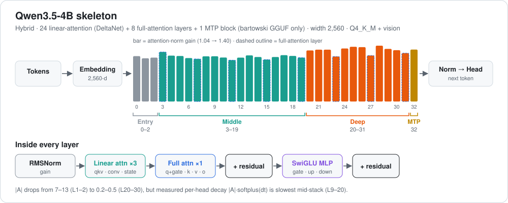

# glb-coder (Qwen3.5-4B GLB 3D Coder): how far it moved from the base

[← all reviews](../README.md)

*Source: the local Ollama model `glb-coder` (`Q4_K_M` GGUF, 4.2B), compared tensor by tensor with the local [Qwen3.5-4B](Qwen3.5-4B.md) and [Qwen3.5-4B-3D-Coder](Qwen3.5-4B-3D-Coder.md) files using the gguf library (153 norm tensors, 273 matrices). No prompts were run and nothing was trained.*

---

## Summary

glb-coder has the same architecture as Qwen3.5-4B, so the full layer story is in the [Qwen3.5-4B review](Qwen3.5-4B.md). This note only measures **how much the fine-tune changed**.

The quant layout differs from the base. glb-coder and 3D-Coder share one layout (Q4_K 2.93B, Q6_K 1.28B params). The base file mixes Q4_K 2.42B, Q6_K 1.03B, Q5_K 0.75B and a little Q8_0.

| Comparison | Norm-gain drift (mean) | Norm-gain drift (max) | Weight-RMS drift (mean) |
|---|---|---|---|
| glb-coder vs 3D-Coder | 0.10% | 0.39% | 1.23% |
| glb-coder vs Qwen3.5-4B | 0.11% | 0.42% | 1.34% |
| 3D-Coder vs Qwen3.5-4B (for scale) | 0.01% | 0.04% | 0.11% |

**Caveat:** weight-RMS drift is measured on quantized Q4/Q6 weights, so part of it can be requantization noise. 3D-Coder went through the same layout change and drifts only 0.11%, so most of glb-coder's 1.2–1.3% is likely real training.

## What it means

- **glb-coder is likely a light fine-tune.** It moved about 10× more than 3D-Coder did, but the change is still around 1% of weight size. Drift does not measure skill, so whether the base skills are intact is a guess, not a test result.
- **3D-Coder is probably very close to the base, but this metric can't prove it.** "Weight-RMS drift" compares one RMS number per matrix, so two different matrices with the same RMS score 0, and Q4_K requantization alone moves RMS by about 0.5%. Norm-gain drift (0.01%) is stronger evidence, but a merged LoRA leaves norms untouched. `tools/drift.py` measures the actual weight difference ‖ΔW‖/‖W‖; run it against a Q8_0 base to settle this.
- **Part of glb-coder's specialty is in its Modelfile.** It asks for one self-contained Three.js HTML file (importmap, OrbitControls, an Export GLB button via GLTFExporter). It sets num_ctx 16384, num_predict 12000 and temperature 0.6. The rest is in the weights, which moved 10× more than 3D-Coder's.

## Verdict

Use glb-coder for "make me a 3D scene I can export as GLB" jobs. For anything else, the plain Qwen3.5-4B is the same base with fewer 3D-specific habits.
