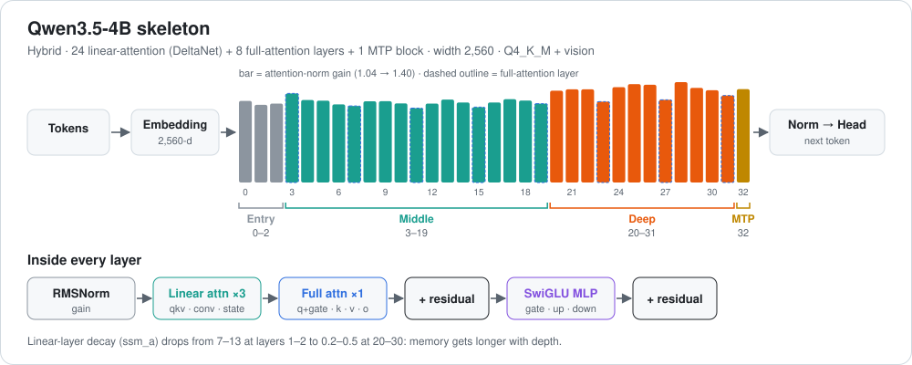

# Qwen3.5-4B: a look inside the layers



[← all reviews](../README.md)

*Source: the local files `Qwen_Qwen3.5-4B-Q4_K_M.gguf` (bartowski, imatrix) and `mmproj-Qwen_Qwen3.5-4B-f16.gguf`, read directly with the gguf library. Every number below is measured from the weights. No prompts were run and nothing was trained.*

---

## 1. Summary

Qwen3.5-4B is a **hybrid** model. Out of 32 layers, 24 use **linear attention** (a Gated DeltaNet-style recurrent memory) and only 8 use full attention, one in every four. A 33rd block is a **multi-token-prediction (MTP)** head for speculative decoding. A 24-layer vision encoder (334M) lets it read images.

The weights show a clear plan: early linear layers forget fast, deep linear layers keep long memory, and the last third of the network is where gains get loud.

---

## 2. The model in one picture

```
 tokens ──► tokenizer (248,320 vocab)
              │
              ▼
 ┌──────────────────────────────────────────┐
 │ embedding 2560-d  (636M, Q6_K, tied)     │
 └──────────────────────────────────────────┘
              │
              ▼  × 32 layers, pattern  L L L F  repeated 8×
 ┌──────────────────────────────────────────┐
 │ L = linear attention (DeltaNet)          │
 │     qkv · gate · conv1d(4) · ssm_out     │  112.9M  (61%)
 │ F = full gated attention (16q / 4kv)     │
 │     q+gate · k · v · o · q/k norm        │  107.5M  (60%)
 │ SwiGLU MLP  2560 → 9216 → 2560           │   70.8M  (39%)
 └──────────────────────────────────────────┘
              │
              ▼
 ┌──────────────────────────────────────────┐
 │ block 32: MTP head (next-next token)     │  all Q8_0
 └──────────────────────────────────────────┘
              │
              ▼
 output norm (gain 3.20) ──► tied head ──► next token

 image ──► ViT 24 layers, 1024-d (334M, f16) ──► merger ──► 2560-d tokens
```

| Item | Value |
|---|---|
| Architecture | `qwen35` hybrid, Apache-2.0 |
| Parameters | 4.33B LLM + 334M vision |
| Layers | 32 + 1 MTP block |
| Width / MLP | 2,560 / 9,216 |
| Attention | 16 query / 4 KV heads, head dim 256 |
| Full-attention layers | 3, 7, 11, 15, 19, 23, 27, 31 |
| Linear-attention state | 16 groups, state 128, inner 4,096, conv kernel 4 |
| Context | 262,144 (RoPE base 10M, multimodal RoPE) |
| Quant | Q4_K_M, imatrix |

**Simple analogy:** most of the layers are a fast note-taker that keeps a running summary instead of re-reading everything. Every fourth layer is a careful reader that looks back at the full text. Because notes are cheap, the long context costs much less memory than a normal transformer.

---

## 3. What the layers do

> **Caveat:** zones come from where the measured numbers shift. They are interpretation of weights, not activation probing.

| Zone | Layers | Attention gain | MLP gain | What it means |
|---|---|---|---|---|
| **Entry** | 0–2 | 1.04–1.10 | 0.95–1.0 | Linear layers with very fast decay (`ssm_a` 7–13 at layers 1–2): short, local memory. Layer 0's decay is tiny (0.09). |
| **Middle** | 3–19 | 1.04–1.16 | ≈1.0 | Steady and calm. Decay 1.6–3.5, then drops below 1 around 16–18. |
| **Deep** | 20–31 | 1.28–1.40 | 1.15–1.42 | Gains jump. Linear decay falls to 0.20–0.47: these layers hold memory across long spans. |
| **MTP** | 32 | 1.30 | n/a | Separate head that guesses the token after next. |

Observations:

- **Memory gets longer with depth.** `ssm_a` (how fast the linear state forgets) goes from 7–13 in layers 1–2 to 0.2–0.5 in layers 20–30. The `ssm_dt` bias falls with it (3–4 → 1.7–2.9). Early layers track nearby words; deep layers carry the thread.
- **Full-attention layers stay quieter** than their linear neighbours in the deep zone (attention gain 1.13–1.22 vs 1.28–1.40). They do precise lookups; the linear layers do the bulk mixing.
- **q/k norms peak at layer 19** (1.64), right before the deep zone starts. That is the sharpest full-attention lookup in the stack.
- **MLP writes are loudest at the ends:** `ffn_down` RMS is 0.0089 at layer 0, about 0.0066 in the middle and 0.0087 at layer 31.

### Every layer (all 33)

#### qwen35 · `blk` (33 blocks)

| L | type | M params | attn_n | q | k | v | o | q_n | k_n | gate_a | f_gate | f_up | f_down | post_a | attn_qkv | ssm_alpha | ssm_beta | ssm_conv1d | ssm_norm | ssm_out | nextn.eh_proj | nextn.enorm | nextn.hnorm | nextn.shared_head_norm |
|---|---|---|---|---|---|---|---|---|---|---|---|---|---|---|---|---|---|---|---|---|---|---|---|---|
| 0 | ffn | 112.9 | 1.139 | · | · | · | · | · | · | 0.0136 | 0.0101 | 0.0077 | 0.0089 | 0.950 | 0.0145 | 0.0259 | 0.0114 | 0.0734 | 0.922 | 0.0160 | · | · | · | · |
| 1 | ffn | 112.9 | 1.085 | · | · | · | · | · | · | 0.0136 | 0.0094 | 0.0078 | 0.0086 | 0.946 | 0.0130 | 0.0247 | 0.0203 | 0.0306 | 0.933 | 0.0139 | · | · | · | · |
| 2 | ffn | 112.9 | 1.103 | · | · | · | · | · | · | 0.0127 | 0.0088 | 0.0076 | 0.0080 | 0.954 | 0.0134 | 0.0204 | 0.0172 | 0.0455 | 0.975 | 0.0131 | · | · | · | · |
| 3 | attn | 107.5 | 1.243 | 0.0126 | 0.0122 | 0.0117 | 0.0128 | 1.357 | 1.343 | · | 0.0091 | 0.0080 | 0.0081 | 0.955 | · | · | · | · | · | · | · | · | · | · |
| 4 | ffn | 112.9 | 1.152 | · | · | · | · | · | · | 0.0142 | 0.0090 | 0.0080 | 0.0079 | 0.966 | 0.0128 | 0.0186 | 0.0144 | 0.0218 | 0.966 | 0.0128 | · | · | · | · |
| 5 | ffn | 112.9 | 1.143 | · | · | · | · | · | · | 0.0135 | 0.0087 | 0.0081 | 0.0078 | 0.991 | 0.0149 | 0.0158 | 0.0130 | 0.0844 | 0.977 | 0.0121 | · | · | · | · |
| 6 | ffn | 112.9 | 1.090 | · | · | · | · | · | · | 0.0125 | 0.0081 | 0.0071 | 0.0072 | 0.990 | 0.0131 | 0.0172 | 0.0121 | 0.0303 | 0.953 | 0.0113 | · | · | · | · |
| 7 | attn | 107.5 | 1.070 | 0.0124 | 0.0117 | 0.0113 | 0.0103 | 1.498 | 1.488 | · | 0.0096 | 0.0083 | 0.0067 | 1.016 | · | · | · | · | · | · | · | · | · | · |
| 8 | ffn | 112.9 | 1.134 | · | · | · | · | · | · | 0.0128 | 0.0093 | 0.0083 | 0.0067 | 1.021 | 0.0140 | 0.0156 | 0.0115 | 0.0595 | 0.953 | 0.0106 | · | · | · | · |
| 9 | ffn | 112.9 | 1.136 | · | · | · | · | · | · | 0.0144 | 0.0089 | 0.0088 | 0.0067 | 1.026 | 0.0154 | 0.0157 | 0.0113 | 0.0910 | 0.988 | 0.0100 | · | · | · | · |
| 10 | ffn | 112.9 | 1.104 | · | · | · | · | · | · | 0.0131 | 0.0083 | 0.0088 | 0.0068 | 1.000 | 0.0160 | 0.0156 | 0.0121 | 0.0835 | 0.981 | 0.0101 | · | · | · | · |
| 11 | attn | 107.5 | 1.039 | 0.0128 | 0.0123 | 0.0118 | 0.0088 | 1.571 | 1.565 | · | 0.0095 | 0.0094 | 0.0066 | 1.007 | · | · | · | · | · | · | · | · | · | · |
| 12 | ffn | 112.9 | 1.102 | · | · | · | · | · | · | 0.0131 | 0.0091 | 0.0082 | 0.0066 | 1.000 | 0.0146 | 0.0171 | 0.0116 | 0.0607 | 0.979 | 0.0094 | · | · | · | · |
| 13 | ffn | 112.9 | 1.158 | · | · | · | · | · | · | 0.0120 | 0.0092 | 0.0083 | 0.0065 | 1.001 | 0.0138 | 0.0142 | 0.0121 | 0.0588 | 1.051 | 0.0091 | · | · | · | · |
| 14 | ffn | 112.9 | 1.118 | · | · | · | · | · | · | 0.0121 | 0.0077 | 0.0081 | 0.0068 | 0.987 | 0.0168 | 0.0158 | 0.0121 | 0.0954 | 1.007 | 0.0096 | · | · | · | · |
| 15 | attn | 107.5 | 1.053 | 0.0120 | 0.0109 | 0.0140 | 0.0089 | 1.591 | 1.585 | · | 0.0083 | 0.0081 | 0.0066 | 1.014 | · | · | · | · | · | · | · | · | · | · |
| 16 | ffn | 112.9 | 1.117 | · | · | · | · | · | · | 0.0114 | 0.0094 | 0.0076 | 0.0070 | 1.012 | 0.0123 | 0.0166 | 0.0104 | 0.0199 | 1.020 | 0.0097 | · | · | · | · |
| 17 | ffn | 112.9 | 1.164 | · | · | · | · | · | · | 0.0115 | 0.0103 | 0.0075 | 0.0069 | 1.014 | 0.0168 | 0.0152 | 0.0108 | 0.0952 | 1.015 | 0.0096 | · | · | · | · |
| 18 | ffn | 112.9 | 1.144 | · | · | · | · | · | · | 0.0121 | 0.0125 | 0.0073 | 0.0076 | 1.039 | 0.0125 | 0.0162 | 0.0103 | 0.0242 | 0.980 | 0.0107 | · | · | · | · |
| 19 | attn | 107.5 | 1.100 | 0.0126 | 0.0109 | 0.0142 | 0.0116 | 1.642 | 1.638 | · | 0.0118 | 0.0075 | 0.0071 | 1.097 | · | · | · | · | · | · | · | · | · | · |
| 20 | ffn | 112.9 | 1.281 | · | · | · | · | · | · | 0.0142 | 0.0142 | 0.0073 | 0.0068 | 1.154 | 0.0157 | 0.0169 | 0.0111 | 0.0889 | 0.892 | 0.0107 | · | · | · | · |
| 21 | ffn | 112.9 | 1.301 | · | · | · | · | · | · | 0.0125 | 0.0131 | 0.0076 | 0.0069 | 1.178 | 0.0166 | 0.0172 | 0.0114 | 0.1227 | 0.875 | 0.0108 | · | · | · | · |
| 22 | ffn | 112.9 | 1.300 | · | · | · | · | · | · | 0.0155 | 0.0145 | 0.0078 | 0.0070 | 1.244 | 0.0141 | 0.0155 | 0.0100 | 0.0579 | 0.930 | 0.0114 | · | · | · | · |
| 23 | attn | 107.5 | 1.129 | 0.0123 | 0.0111 | 0.0167 | 0.0110 | 1.510 | 1.492 | · | 0.0123 | 0.0078 | 0.0068 | 1.225 | · | · | · | · | · | · | · | · | · | · |
| 24 | ffn | 112.9 | 1.332 | · | · | · | · | · | · | 0.0143 | 0.0134 | 0.0076 | 0.0066 | 1.276 | 0.0126 | 0.0180 | 0.0117 | 0.0318 | 0.817 | 0.0110 | · | · | · | · |
| 25 | ffn | 112.9 | 1.373 | · | · | · | · | · | · | 0.0151 | 0.0138 | 0.0077 | 0.0065 | 1.336 | 0.0151 | 0.0173 | 0.0122 | 0.0989 | 0.841 | 0.0106 | · | · | · | · |
| 26 | ffn | 112.9 | 1.365 | · | · | · | · | · | · | 0.0154 | 0.0136 | 0.0080 | 0.0067 | 1.400 | 0.0138 | 0.0178 | 0.0125 | 0.0667 | 0.915 | 0.0108 | · | · | · | · |
| 27 | attn | 107.5 | 1.154 | 0.0116 | 0.0101 | 0.0177 | 0.0120 | 1.442 | 1.416 | · | 0.0128 | 0.0080 | 0.0070 | 1.385 | · | · | · | · | · | · | · | · | · | · |
| 28 | ffn | 112.9 | 1.401 | · | · | · | · | · | · | 0.0158 | 0.0133 | 0.0083 | 0.0070 | 1.397 | 0.0156 | 0.0173 | 0.0109 | 0.0974 | 0.944 | 0.0109 | · | · | · | · |
| 29 | ffn | 112.9 | 1.321 | · | · | · | · | · | · | 0.0155 | 0.0127 | 0.0086 | 0.0072 | 1.419 | 0.0142 | 0.0195 | 0.0130 | 0.0980 | 1.044 | 0.0109 | · | · | · | · |
| 30 | ffn | 112.9 | 1.288 | · | · | · | · | · | · | 0.0152 | 0.0112 | 0.0087 | 0.0076 | 1.366 | 0.0165 | 0.0204 | 0.0120 | 0.1246 | 1.099 | 0.0112 | · | · | · | · |
| 31 | attn | 107.5 | 1.215 | 0.0115 | 0.0102 | 0.0209 | 0.0129 | 1.413 | 1.400 | · | 0.0133 | 0.0107 | 0.0087 | 1.235 | · | · | · | · | · | · | · | · | · | · |
| 32 | attn | 120.6 | 1.304 | 0.0113 | 0.0112 | 0.0227 | 0.0171 | 1.746 | 1.735 | · | 0.0120 | 0.0118 | 0.0108 | 1.385 | · | · | · | · | · | · | 0.0080 | 0.591 | 0.755 | 3.575 |

### Vision encoder (mmproj)

A 24-layer ViT, width 1,024, patch 16, 768-px input, 2×2 spatial merge, then a 2-layer projector (4096 → 4096 → 2560) into the LLM. It has two patch-embedding weights (a temporal pair, so it can take video frames).

- Attention norm climbs from 0.54 (layer 0) to 1.57 (layer 20).
- The **MLP norm explodes in the second half**: about 1 in layers 1–13, then 3.1 → 5.3 → 8.4 → **12.1 at layer 21**. Deep vision layers are where image features get pushed hardest.
- Attention output RMS stays flat at about 0.013.

#### qwen35_proj · `v.blk` (24 blocks)

| L | type | M params | o | f_up | f_down | attn_qkv | ln1 | ln2 |
|---|---|---|---|---|---|---|---|---|
| 0 | ffn | 12.6 | 0.0131 | 0.0185 | 0.0164 | 0.0217 | 0.545 | 2.061 |
| 1 | ffn | 12.6 | 0.0138 | 0.0184 | 0.0163 | 0.0292 | 0.554 | 0.917 |
| 2 | ffn | 12.6 | 0.0138 | 0.0166 | 0.0146 | 0.0227 | 0.648 | 1.050 |
| 3 | ffn | 12.6 | 0.0142 | 0.0164 | 0.0164 | 0.0200 | 0.778 | 0.927 |
| 4 | ffn | 12.6 | 0.0143 | 0.0168 | 0.0172 | 0.0196 | 0.710 | 0.954 |
| 5 | ffn | 12.6 | 0.0145 | 0.0167 | 0.0164 | 0.0167 | 0.788 | 0.923 |
| 6 | ffn | 12.6 | 0.0140 | 0.0166 | 0.0159 | 0.0200 | 0.956 | 0.908 |
| 7 | ffn | 12.6 | 0.0140 | 0.0162 | 0.0143 | 0.0176 | 0.908 | 1.006 |
| 8 | ffn | 12.6 | 0.0134 | 0.0163 | 0.0136 | 0.0190 | 0.904 | 1.007 |
| 9 | ffn | 12.6 | 0.0129 | 0.0161 | 0.0131 | 0.0185 | 1.000 | 1.108 |
| 10 | ffn | 12.6 | 0.0129 | 0.0157 | 0.0131 | 0.0165 | 0.985 | 1.175 |
| 11 | ffn | 12.6 | 0.0130 | 0.0153 | 0.0141 | 0.0166 | 1.093 | 1.357 |
| 12 | ffn | 12.6 | 0.0132 | 0.0150 | 0.0140 | 0.0178 | 1.168 | 1.351 |
| 13 | ffn | 12.6 | 0.0132 | 0.0146 | 0.0135 | 0.0156 | 1.268 | 1.371 |
| 14 | ffn | 12.6 | 0.0132 | 0.0135 | 0.0138 | 0.0161 | 1.320 | 3.066 |
| 15 | ffn | 12.6 | 0.0131 | 0.0137 | 0.0141 | 0.0155 | 1.345 | 4.458 |
| 16 | ffn | 12.6 | 0.0132 | 0.0135 | 0.0140 | 0.0155 | 1.445 | 5.332 |
| 17 | ffn | 12.6 | 0.0134 | 0.0132 | 0.0141 | 0.0149 | 1.529 | 6.059 |
| 18 | ffn | 12.6 | 0.0131 | 0.0132 | 0.0149 | 0.0145 | 1.553 | 8.378 |
| 19 | ffn | 12.6 | 0.0130 | 0.0134 | 0.0153 | 0.0139 | 1.526 | 9.975 |
| 20 | ffn | 12.6 | 0.0133 | 0.0135 | 0.0157 | 0.0140 | 1.571 | 11.234 |
| 21 | ffn | 12.6 | 0.0137 | 0.0136 | 0.0154 | 0.0145 | 1.491 | 12.119 |
| 22 | ffn | 12.6 | 0.0140 | 0.0138 | 0.0149 | 0.0131 | 1.473 | 10.876 |
| 23 | ffn | 12.6 | 0.0176 | 0.0134 | 0.0159 | 0.0151 | 1.410 | 7.651 |

### Where the compression spent its bits

- Linear-attention `qkv` in every layer: **Q6_K**. The quantizer protected the recurrent memory inputs.
- `ffn_down`: 16 layers Q6_K, 16 layers Q4_K. `ssm_out`: half Q8_0.
- Full-attention q/v: Q6_K at layers 3, 15, 27, 31; Q4_K elsewhere.
- The MTP block is all **Q8_0**.
- Embedding: Q6_K. Vision encoder: f16 (no loss).

---

## 4. What's strong

1. **Cheap long context.** Only 8 of 32 layers keep a KV cache, so 262K context fits in far less memory than a dense 4B model.
2. **Clear memory plan.** Decay values show an orderly short-to-long memory ladder.
3. **Built-in speed-up.** The MTP block allows speculative decoding without a separate draft model.
4. **Vision included** with a full-precision encoder.
5. **Careful quant.** The sensitive parts (linear qkv, MTP, embedding) got 6–8 bits.

## 5. Weak spots

1. **Linear layers lose detail.** A recurrent state of 128 per group is a summary; exact recall of a long-ago token rests on the 8 full-attention layers.
2. **Newer runtime needed.** The `qwen35` architecture and its MTP head need a recent llama.cpp / LM Studio; older builds can't load it.
3. **Deep vision MLPs are very loud** (gain 12 at layer 21), so the encoder may be sensitive to further quantization.
4. **Half the MLP down-projections are Q4_K**, the most lossy part of the file.

---

## 6. Surgical map: where to edit what

| Goal | Best place | Why |
|---|---|---|
| Fact edit (ROME-style) | MLP of layers 8–18 | Calm middle, gain ≈1, where stored associations usually sit. |
| Steering vector | Residual after layer 19 | Last calm layer before the loud deep zone; q/k peak shows it's a focus point. |
| Long-context behaviour | Full-attention layers 23, 27, 31 | They do the exact lookups the linear layers can't. |
| LoRA for style / format | Linear `attn_qkv` + `ssm_out` in 20–31 | Deep zone shapes the output; memory is long there. |
| Vision tweaks | Projector `mm.0` / `mm.2` | Small, sits between two frozen stacks. |
| **Leave alone** | Layers 0–2, block 32 (MTP), `ssm_a` / `ssm_dt` everywhere | Changing decay breaks memory; MTP must match the main head. |

> To confirm a zone before editing, run a probe: log the residual norm per layer on a few prompts and check that the jump really happens near layer 20.

---

## 7. Verdict

The most advanced design in this collection. Qwen3.5-4B swaps three out of four attention layers for a recurrent memory, adds a speculative-decoding head and a full-precision vision encoder, and still fits a 6 GB GPU. The weights show an orderly design: fast memory early, long memory deep, loud decision layers at the end. Best pick here for long documents and images.
