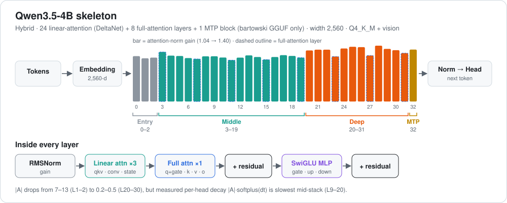

# Qwen3.5-9B: a look inside the layers



[← all reviews](../README.md)

*Source: the local Ollama blob for `Qwen3.5-9B` (Unsloth `Q4_K_M` GGUF), read directly with the gguf library. Every number below is measured from the weights. No prompts were run and nothing was trained. The 918 MB vision projector that ships with it was not measured.*

---

## 1. Summary

Qwen3.5-9B is the big sibling of [Qwen3.5-4B](Qwen3.5-4B.md): the same **hybrid** design, with 24 linear-attention layers and 8 full-attention layers (one in every four), but wider (4096 vs 2560) and with an **untied** output head. This GGUF has **no MTP block**, so speculative decoding with the model's own head is not available from this file.

The layer story matches the 4B: early linear layers have the largest \|A\|, deep linear layers the smallest, and the residual gains get loud in the last third. Once the dt bias is factored in, the slowest baseline decay sits in the middle layers (lowest at 16, 18 and 20), not the deepest ones (see section 3). At about 5.5 GB of Q4_K_M weights it will not fit fully in 6 GB VRAM, so expect partial CPU offload (an informal separate run gave about 9 tok/s; not part of this weight analysis).

---

## 2. The model in one picture

```
 tokens ──► tokenizer (248,320 vocab)
              │
              ▼
 ┌──────────────────────────────────────────┐
 │ embedding 4096-d  (Q4_K, untied)         │
 └──────────────────────────────────────────┘
              │
              ▼  × 32 layers, pattern  L L L F  repeated 8×
 ┌──────────────────────────────────────────┐
 │ L = linear attention (Gated DeltaNet)    │
 │     qkv · gate · conv1d(4) · ssm_out     │  ~218M per block
 │ F = full gated attention (16q / 4kv)     │
 │     q+gate · k · v · o · q/k norm        │  ~210M per block
 │ SwiGLU MLP  4096 → 12288 → 4096          │
 └──────────────────────────────────────────┘
              │
              ▼
 ┌──────────────────────────────────────────┐
 │ output_norm → output head (Q6_K, own     │
 │ weights, not shared with the embedding)  │
 └──────────────────────────────────────────┘
```

| Fact | Value |
|---|---|
| Parameters (text) | 8.95B |
| Layers | 32 (24 linear + 8 full, full at 3, 7, 11 … 31) |
| Width / MLP | 4096 / 12288 |
| Heads | 16 query / 4 KV, head dim 256 |
| Linear-attn state | state 128, 16 groups, inner 4096, dt rank 32, conv 4 |
| Context | 262,144 (RoPE base 10M, sections [11, 11, 10, 0]) |
| Vocab | 248,320 |
| Head | untied, Q6_K |
| MTP block | not present in this GGUF |
| License | Apache-2.0 |

---

## 3. What the layers do

> **Caveat.** These are weight statistics, not behaviour tests. A norm gain says how loudly a layer writes into the residual stream; it does not say what the layer "knows". Read zones as hints, not proof.

| Zone | Layers | Attention gain | MLP gain | What it means |
|---|---|---|---|---|
| Entry | 0–2 | attn_norm 1.03–1.09 | post-attn 0.87–0.91 | Layer 0 barely decays its memory (0.046) and has a mean dt bias of +2.37, driven by a few large positive heads (max 18.5): it passes tokens through almost raw. Layers 1–2 jump to the strongest decay in the model (6.1, 12.6): very short memory, local patterns. |
| Early | 3–14 | 1.0–1.2 | 0.93–1.00 | Decay settles at 1.8–3.9. Short-to-medium memory. The full-attention q/k norms climb from 1.34 to 1.58. |
| Middle | 15–19 | ~1.0–1.1 | ~0.97–1.0 | Decay falls to 0.8–2.6. q/k norms peak (1.59 at layers 15 and 19): which suggests the sharpest global attention may be here. |
| Late | 20–31 | 1.03–1.24 | 1.04–1.33 | Decay drops to 0.16–0.44: the smallest |A| (suggesting slower decay, partly offset by higher dt). dt bias rises from about −3 toward 0. Post-attention gain peaks at **1.325 on layer 29**. ssm_norm rises from 0.81–0.87 (20–25) to 1.15 (30). This is where the model writes hardest. |

**Observations**

- **|A| shrinks with depth (suggesting slower decay), though the rising dt bias partly offsets this.** ssm_a decay goes 12.6 (layer 2) → ~3 (early) → ~1.5 (middle) → 0.16–0.44 (late). Same plan as the 4B, at a larger scale.
- **dt bias flips in the last third.** It sits at −2.9 to −4.2 up to layer 19, then rises to −2.0 (21) and −0.99 (22), hovers near 0 at layers 26–29 (+0.09, +0.01, −0.14), and is back to −1.1 at 30. In Gated DeltaNet the dt bias only enters the decay gate (decay per step = \|A\| × softplus(dt_bias + input term)); write strength is set by the separate beta gate. So a higher dt here means faster forgetting, not bolder writes. Using layer means, \|A\| × softplus(dt_bias) is about 0.14–0.24 in layers 1–5, 0.016–0.067 in layers 8–21 (lowest at 16, 18 and 20), and 0.03–0.19 in layers 22–30 (approximate: per-head values and the input term were not computed).
- **Full-attention sharpness is a hump.** q/k norms run 1.34 → 1.59 (middle) → 1.42 (last). The middle full-attention layers are the most selective.
- **Late full-attention layers write louder.** attn_output RMS rises from 0.015 to 0.021 (layer 27), and v RMS climbs to 0.029 at layer 31.
- **The MLP is quiet everywhere.** ffn_up RMS is 0.011–0.013 across all layers, so the MLP weights are fairly flat compared with the norm gains, which carry most of the depth-wise change.

### Every layer

Gains are the mean absolute value of each norm. Matrices are the RMS of the first 256 rows. The quant type is in brackets when it is not Q4_K. `·` means the layer does not have that tensor.

| L | type | M params | attn_n | q | k | v | o | q_n | k_n | gate_a | attn_qkv | post_a | f_gate | f_up | f_down | ssm_a decay | dt_bias (mean) | ssm_alpha | ssm_beta | ssm_conv1d | ssm_norm | ssm_out |
|---|---|---|---|---|---|---|---|---|---|---|---|---|---|---|---|---|---|---|---|---|---|---|
| 0 | linear | 218 | 1.033 | · | · | · | · | · | · | 0.017 | 0.017 (Q5_K) | 0.887 | 0.011 | 0.011 | 0.011 (Q6_K) | 0.046 | +2.37 | 0.025 (Q8_0) | 0.008 (Q8_0) | 0.062 (F32) | 0.881 | 0.015 (Q5_K) |
| 1 | linear | 218 | 1.052 | · | · | · | · | · | · | 0.017 | 0.017 (Q5_K) | 0.908 | 0.011 | 0.011 | 0.011 (Q6_K) | 6.057 | -3.32 | 0.031 (Q8_0) | 0.025 (Q8_0) | 0.048 (F32) | 0.851 | 0.016 (Q5_K) |
| 2 | linear | 218 | 1.087 | · | · | · | · | · | · | 0.016 | 0.017 (Q5_K) | 0.874 | 0.012 | 0.011 | 0.011 (Q6_K) | 12.6 | -3.96 | 0.026 (Q8_0) | 0.021 (Q8_0) | 0.058 (F32) | 0.919 | 0.016 (Q5_K) |
| 3 | full | 210 | 1.195 | 0.016 | 0.016 | 0.015 (Q6_K) | 0.015 | 1.341 | 1.326 | · | · | 0.927 | 0.012 | 0.011 | 0.011 (Q6_K) | · | · | · | · | · | · | · |
| 4 | linear | 218 | 1.141 | · | · | · | · | · | · | 0.018 | 0.017 (Q5_K) | 0.930 | 0.011 | 0.011 | 0.011 | 3.934 | -3.33 | 0.024 (Q8_0) | 0.018 (Q8_0) | 0.029 (F32) | 0.906 | 0.016 (Q5_K) |
| 5 | linear | 218 | 1.119 | · | · | · | · | · | · | 0.017 | 0.018 (Q5_K) | 0.952 | 0.012 | 0.011 | 0.011 | 2.443 | -2.87 | 0.019 (Q8_0) | 0.015 (Q8_0) | 0.097 (F32) | 0.904 | 0.016 (Q5_K) |
| 6 | linear | 218 | 1.074 | · | · | · | · | · | · | 0.016 | 0.017 (Q5_K) | 0.938 | 0.012 | 0.011 | 0.011 (Q6_K) | 3.599 | -3.75 | 0.020 (Q8_0) | 0.014 (Q8_0) | 0.043 (F32) | 0.881 | 0.016 (Q5_K) |
| 7 | full | 210 | 1.021 | 0.016 | 0.016 | 0.015 (Q6_K) | 0.015 | 1.492 | 1.486 | · | · | 0.979 | 0.012 | 0.011 | 0.011 | · | · | · | · | · | · | · |
| 8 | linear | 218 | 1.107 | · | · | · | · | · | · | 0.016 | 0.018 (Q5_K) | 0.967 | 0.012 | 0.011 | 0.011 | 1.873 | -3.43 | 0.018 (Q8_0) | 0.013 (Q8_0) | 0.069 (F32) | 0.875 | 0.015 (Q5_K) |
| 9 | linear | 218 | 1.099 | · | · | · | · | · | · | 0.017 | 0.019 (Q5_K) | 0.977 | 0.012 | 0.011 | 0.011 (Q6_K) | 1.793 | -3.85 | 0.017 (Q8_0) | 0.012 (Q8_0) | 0.099 (F32) | 0.925 | 0.016 (Q5_K) |
| 10 | linear | 218 | 1.068 | · | · | · | · | · | · | 0.016 | 0.019 (Q5_K) | 0.970 | 0.012 | 0.011 | 0.011 | 2.553 | -4.20 | 0.017 (Q8_0) | 0.013 (Q8_0) | 0.095 (F32) | 0.922 | 0.015 (Q5_K) |
| 11 | full | 210 | 0.987 | 0.017 | 0.016 | 0.016 (Q6_K) | 0.015 | 1.583 | 1.574 | · | · | 1.000 | 0.011 | 0.011 | 0.011 | · | · | · | · | · | · | · |
| 12 | linear | 218 | 1.068 | · | · | · | · | · | · | 0.016 | 0.018 (Q5_K) | 0.985 | 0.011 | 0.011 | 0.011 (Q6_K) | 3.406 | -3.92 | 0.019 (Q8_0) | 0.013 (Q8_0) | 0.070 (F32) | 0.935 | 0.015 (Q5_K) |
| 13 | linear | 218 | 1.105 | · | · | · | · | · | · | 0.015 | 0.017 (Q5_K) | 0.983 | 0.011 | 0.011 | 0.011 | 2.468 | -3.63 | 0.016 (Q8_0) | 0.013 (Q8_0) | 0.065 (F32) | 1.040 | 0.015 (Q5_K) |
| 14 | linear | 218 | 1.065 | · | · | · | · | · | · | 0.015 | 0.020 (Q5_K) | 0.966 | 0.011 | 0.011 | 0.011 | 3.708 | -3.81 | 0.017 (Q8_0) | 0.013 (Q8_0) | 0.101 (F32) | 0.977 | 0.015 (Q5_K) |
| 15 | full | 210 | 1.005 | 0.016 | 0.015 | 0.018 (Q6_K) | 0.015 | 1.591 | 1.583 | · | · | 0.994 | 0.011 | 0.011 | 0.011 (Q6_K) | · | · | · | · | · | · | · |
| 16 | linear | 218 | 1.068 | · | · | · | · | · | · | 0.014 | 0.017 (Q5_K) | 0.976 | 0.011 | 0.012 | 0.011 | 0.768 | -3.85 | 0.017 (Q8_0) | 0.010 (Q8_0) | 0.030 (F32) | 0.995 | 0.015 (Q5_K) |
| 17 | linear | 218 | 1.103 | · | · | · | · | · | · | 0.014 | 0.020 (Q5_K) | 0.966 | 0.011 | 0.012 | 0.011 | 2.556 | -3.68 | 0.015 (Q8_0) | 0.010 (Q8_0) | 0.099 (F32) | 0.994 | 0.015 (Q5_K) |
| 18 | linear | 218 | 1.070 | · | · | · | · | · | · | 0.014 | 0.016 (Q5_K) | 0.969 | 0.011 | 0.012 | 0.011 (Q6_K) | 0.902 | -3.53 | 0.016 (Q8_0) | 0.010 (Q8_0) | 0.030 (F32) | 0.933 | 0.015 (Q5_K) |
| 19 | full | 210 | 1.025 | 0.017 | 0.015 | 0.018 | 0.017 | 1.592 | 1.594 | · | · | 1.014 | 0.011 | 0.012 | 0.011 | · | · | · | · | · | · | · |
| 20 | linear | 218 | 1.154 | · | · | · | · | · | · | 0.016 | 0.019 (Q5_K) | 1.043 | 0.012 | 0.012 | 0.011 | 0.443 | -3.00 | 0.016 (Q8_0) | 0.010 (Q8_0) | 0.084 (F32) | 0.836 | 0.015 (Q5_K) |
| 21 | linear | 218 | 1.146 | · | · | · | · | · | · | 0.014 | 0.019 (Q5_K) | 1.059 | 0.012 | 0.012 | 0.011 (Q6_K) | 0.263 | -2.02 | 0.017 (Q8_0) | 0.010 (Q8_0) | 0.123 (F32) | 0.823 | 0.015 (Q5_K) |
| 22 | linear | 218 | 1.139 | · | · | · | · | · | · | 0.017 | 0.017 (Q5_K) | 1.119 | 0.013 | 0.012 | 0.011 | 0.252 | -0.99 | 0.015 (Q8_0) | 0.009 (Q8_0) | 0.058 (F32) | 0.874 | 0.015 (Q5_K) |
| 23 | full | 210 | 1.031 | 0.016 | 0.014 | 0.022 | 0.018 | 1.522 | 1.499 | · | · | 1.115 | 0.012 | 0.012 | 0.012 | · | · | · | · | · | · | · |
| 24 | linear | 218 | 1.166 | · | · | · | · | · | · | 0.016 | 0.016 (Q5_K) | 1.160 | 0.013 | 0.012 | 0.012 (Q6_K) | 0.156 | -1.47 | 0.017 (Q8_0) | 0.010 (Q8_0) | 0.033 (F32) | 0.812 | 0.015 (Q5_K) |
| 25 | linear | 218 | 1.188 | · | · | · | · | · | · | 0.017 | 0.018 (Q5_K) | 1.219 | 0.013 | 0.012 | 0.012 | 0.264 | -1.04 | 0.017 (Q8_0) | 0.011 (Q8_0) | 0.091 (F32) | 0.846 | 0.016 (Q5_K) |
| 26 | linear | 218 | 1.190 | · | · | · | · | · | · | 0.017 | 0.017 (Q5_K) | 1.279 | 0.013 | 0.012 | 0.012 | 0.166 | +0.09 | 0.018 (Q8_0) | 0.011 (Q8_0) | 0.065 (F32) | 0.917 | 0.016 (Q5_K) |
| 27 | full | 210 | 1.079 | 0.015 | 0.013 | 0.022 (Q6_K) | 0.021 | 1.447 | 1.416 | · | · | 1.278 | 0.014 | 0.012 | 0.012 (Q6_K) | · | · | · | · | · | · | · |
| 28 | linear | 218 | 1.239 | · | · | · | · | · | · | 0.017 | 0.018 (Q5_K) | 1.294 | 0.014 | 0.013 | 0.012 (Q6_K) | 0.277 | +0.01 | 0.017 (Q8_0) | 0.010 (Q8_0) | 0.091 (F32) | 0.964 | 0.016 (Q5_K) |
| 29 | linear | 218 | 1.166 | · | · | · | · | · | · | 0.017 | 0.017 (Q5_K) | 1.325 | 0.014 | 0.013 | 0.012 (Q6_K) | 0.157 | -0.14 | 0.020 (Q8_0) | 0.012 (Q8_0) | 0.074 (F32) | 1.087 | 0.016 (Q5_K) |
| 30 | linear | 218 | 1.150 | · | · | · | · | · | · | 0.018 | 0.019 (Q5_K) | 1.288 | 0.013 | 0.013 | 0.012 (Q6_K) | 0.192 | -1.09 | 0.020 (Q8_0) | 0.010 (Q8_0) | 0.103 (F32) | 1.154 | 0.016 (Q5_K) |
| 31 | full | 210 | 1.127 | 0.015 | 0.013 | 0.029 | 0.018 | 1.417 | 1.403 | · | · | 1.213 | 0.014 | 0.013 | 0.011 (Q6_K) | · | · | · | · | · | · | · |

### Where the compression spent its bits

| Quant | Params | Where |
|---|---|---|
| Q4_K | 5,895M | most matrices, including the embedding |
| Q6_K | 1,843M | output head, full-attention v (most layers), ffn_down at layers 0–3, 6, 9, 12, 15, 18, 21, 24, 27–31 |
| Q5_K | 1,208M | every linear layer's attn_qkv and ssm_out |
| Q8_0 | 6M | ssm_alpha, ssm_beta (tiny, kept precise) |
| F32 | small | conv1d, norms, ssm_a, dt bias |

The recurrent path (qkv and ssm_out at Q5_K, alpha and beta at Q8_0) and the first and last few ffn_down layers got more bits. This is llama.cpp's fixed Q4_K_M type rule (`use_more_bits` in `src/llama-quant.cpp`), applied by position, not a measurement of which parts are sensitive.

---

## 4. What's strong

- **Long context by design.** 262K positions, with only 8 layers paying the full-attention KV cost. The other 24 keep a fixed-size state.
- **A clean depth plan.** The decay, dt bias and gain curves are broadly trend with depth, with some jitter (e.g. decay 0.77 → 2.56 → 0.90 at layers 16–18). No single layer dominates the gains.
- **Untied head.** A separate Q6_K output matrix gives the head its own capacity, unlike the 4B's shared embedding.
- **Same family as the 4B.** Prompts, templates and tools that work on Qwen3.5-4B carry over.

## 5. Weak spots

- **Too big for 6 GB of VRAM.** At about 5.5 GB it will not fit fully in 6 GB VRAM, so expect partial CPU offload and slower replies than the 4B. It is a "quality when you can wait" model.
- **No MTP head in this file.** The [4B review](Qwen3.5-4B.md) reports an MTP block; this file has none.
- **Most of the weights are at 4 bits.** The Q4_K embedding is lower than the 4B's Q6_K one, so rare tokens may suffer slightly.
- **The vision path is unmeasured.** The projector was not reviewed, so no claims are made about image quality.

## 6. Surgical map

| Goal | Best place | Why |
|---|---|---|
| Style / tone LoRA | late MLP + attn_output, layers 20–31 | The highest gains live here. Small changes show up strongly. |
| Long-context recall | linear layers 16–21 (ssm_out, dt bias) | Slowest baseline decay once dt bias is included (layer means, not per head). |
| Retrieval / copying | full-attention layers 11–19 (q, k) | Highest q/k norm gains (~1.59), which may mean the sharpest attention. |
| Steering vectors | residual stream around layers 16–22 | The memory regime changes here. A good place to read and write concepts. |
| Leave alone | layers 0–2, ssm_a, conv1d | The entry layers set the token-mixing base. Changing them likely affects everything downstream (not tested). |

---

## 7. Verdict

A scaled-up Qwen3.5-4B with the same healthy, smooth layer plan and its own output head. On this laptop it is the **slow, smarter option**. Use it when quality matters more than speed, and use the 4B for anything interactive.
