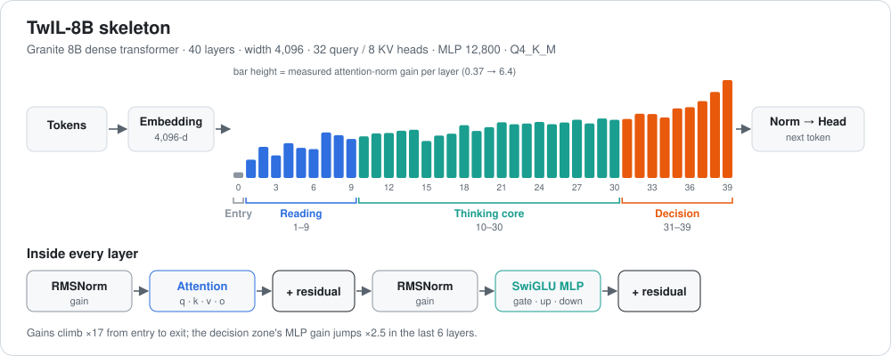

# TwIL-8B: a look inside the layers



[← all reviews](../README.md)

*Source: the local file `TwIL-8B-Q4_K_M-balanced.gguf`, read directly with the `gguf` library. Norm values are exact. Weight sizes are the RMS of the first 256 rows of each matrix after un-quantizing.*

---

## 1. Summary

TwIL-8B is an **8.8-billion-parameter model built on IBM's Granite design**. Its internal name is "Granite8B L2Sv2 S30". It was fine-tuned and then compressed to 4-bit ("Q4_K_M balanced"). The compression was calibrated on TwIL's own domain data (`twil-domains` imatrix), so the bits were spent where TwIL's tasks need them.

It is a **standard, clean transformer**:
- no mixture-of-experts;
- no unusual blocks;
- 40 identical layers stacked on top of each other.

That makes it a good model to study and to edit surgically.

---

## 2. The model in one picture

```
 text ─► TOKENIZER (100,352 word-pieces)
          │
          ▼
 EMBEDDING  411M params   turns each token into a list of 4,096 numbers
          │
          ▼
 ┌─────────────────── LAYER × 40 (each ~199M params) ───────────────────┐
 │  RMSNorm  ─► ATTENTION  "look at other tokens"        ~42M  (21%)    │
 │               32 question heads, 8 shared key/value heads             │
 │  RMSNorm  ─► MLP        "think about what was found"  ~157M (79%)    │
 │               12,800 neurons                                          │
 └───────────────────────────────────────────────────────────────────────┘
          │
          ▼
 OUTPUT HEAD  411M params  scores all 100,352 tokens ─► next word
```

| Item | Value |
|---|---|
| Total parameters | 8,791,592,960 |
| Layers | 40 |
| Width (numbers per token) | 4,096 |
| MLP neurons | 12,800 per layer, **512,000 total** |
| Attention heads | 32 per layer, **1,280 total** (8 key/value groups per layer, which saves memory) |
| Max context | 131,072 tokens (RoPE base 10,000,000, built for long text) |
| Default sampling | temperature 1.0, top_p 0.95 |

**Simple analogy.** Each layer is one round of a meeting:
1. **Attention** is everyone looking around the table: "which earlier words matter for this one?"
2. **The MLP** is each person thinking alone, using what they know.

This repeats 40 times. Each round refines the answer a little more.

---

## 3. What the layers do

> **Caveat:** the numbers below are measured from the weights. The "what it means" column is an informed reading of those numbers plus what is known about similar transformers. It is not proven for TwIL. Proof needs activation probing (see section 6).

Each layer has two **norm gains**: one before attention, one before the MLP. They act as volume knobs on how strongly that layer pushes its result forward. Here is how they change with depth.

| Zone | Layers | Attention gain | MLP gain | What it means |
|---|---|---|---|---|
| **Entry** | 0 | 0.37 | 0.59 | Very quiet. Mostly passes the raw token meaning through. |
| **Reading** | 1–9 | 1.2 → 2.8 | 0.8 → 1.1 | Climbs fast. Builds syntax, local patterns and "what kind of text is this". |
| **Thinking core** | 10–30 | 2.7 → 3.8 | 1.2 → 1.55 | Flat and steady. Logic, code structure, facts. All 21 layers look nearly alike. |
| **Decision** | 31–39 | 3.8 → **6.4** | 1.6 → **4.0** | Gains shoot up, with the MLP gain ×2.5 in 6 layers. The model commits to an answer and shapes the exact next token. |

Attention also changes shape near the end:
- **Key size falls by half** (0.018 → 0.008).
- **Value size doubles** (0.010 → 0.020).

So late layers care less about *where* to look and more about *what* to copy in. They are gathering final details for the answer.

The **MLP weights stay very even everywhere**: down-projection RMS is 0.0031–0.0033 in every layer. Where a layer's influence differs, it comes from the norm gains, not from the MLP weights.

### Every layer (all 40)

#### twil · `blk` (40 blocks)

| L | type | M params | attn_n | q | k | v | o | ffn_n | f_gate | f_up | f_down |
|---|---|---|---|---|---|---|---|---|---|---|---|
| 0 | attn | 199.2 | 0.373 | 0.0124 | 0.0184 | 0.0094 | 0.0019 | 0.592 | 0.0099 | 0.0131 | 0.0033 |
| 1 | attn | 199.2 | 1.198 | 0.0144 | 0.0182 | 0.0104 | 0.0025 | 1.008 | 0.0107 | 0.0153 | 0.0036 |
| 2 | attn | 199.2 | 2.028 | 0.0146 | 0.0186 | 0.0103 | 0.0027 | 0.806 | 0.0129 | 0.0146 | 0.0033 |
| 3 | attn | 199.2 | 1.473 | 0.0131 | 0.0184 | 0.0109 | 0.0027 | 0.859 | 0.0131 | 0.0139 | 0.0032 |
| 4 | attn | 199.2 | 2.268 | 0.0158 | 0.0175 | 0.0099 | 0.0027 | 0.950 | 0.0132 | 0.0137 | 0.0032 |
| 5 | attn | 199.2 | 1.970 | 0.0159 | 0.0175 | 0.0119 | 0.0028 | 1.005 | 0.0133 | 0.0136 | 0.0031 |
| 6 | attn | 199.2 | 1.883 | 0.0130 | 0.0165 | 0.0118 | 0.0027 | 1.003 | 0.0133 | 0.0136 | 0.0031 |
| 7 | attn | 199.2 | 2.969 | 0.0144 | 0.0181 | 0.0112 | 0.0026 | 1.097 | 0.0135 | 0.0134 | 0.0031 |
| 8 | attn | 199.2 | 2.790 | 0.0146 | 0.0152 | 0.0120 | 0.0027 | 1.145 | 0.0134 | 0.0135 | 0.0031 |
| 9 | attn | 199.2 | 2.550 | 0.0153 | 0.0158 | 0.0122 | 0.0028 | 1.119 | 0.0131 | 0.0136 | 0.0031 |
| 10 | attn | 199.2 | 2.715 | 0.0169 | 0.0188 | 0.0112 | 0.0028 | 1.230 | 0.0136 | 0.0133 | 0.0031 |
| 11 | attn | 199.2 | 2.907 | 0.0165 | 0.0190 | 0.0115 | 0.0028 | 1.299 | 0.0134 | 0.0131 | 0.0031 |
| 12 | attn | 199.2 | 2.938 | 0.0150 | 0.0170 | 0.0108 | 0.0028 | 1.341 | 0.0133 | 0.0133 | 0.0031 |
| 13 | attn | 199.2 | 3.083 | 0.0156 | 0.0172 | 0.0116 | 0.0028 | 1.329 | 0.0132 | 0.0135 | 0.0031 |
| 14 | attn | 199.2 | 3.143 | 0.0164 | 0.0192 | 0.0123 | 0.0028 | 1.306 | 0.0131 | 0.0138 | 0.0032 |
| 15 | attn | 199.2 | 2.413 | 0.0143 | 0.0140 | 0.0109 | 0.0027 | 1.234 | 0.0131 | 0.0139 | 0.0032 |
| 16 | attn | 199.2 | 2.765 | 0.0149 | 0.0179 | 0.0089 | 0.0025 | 1.287 | 0.0128 | 0.0141 | 0.0032 |
| 17 | attn | 199.2 | 2.892 | 0.0163 | 0.0177 | 0.0103 | 0.0026 | 1.294 | 0.0128 | 0.0142 | 0.0032 |
| 18 | attn | 199.2 | 3.443 | 0.0156 | 0.0183 | 0.0103 | 0.0026 | 1.279 | 0.0126 | 0.0141 | 0.0032 |
| 19 | attn | 199.2 | 3.070 | 0.0141 | 0.0181 | 0.0101 | 0.0027 | 1.284 | 0.0126 | 0.0143 | 0.0032 |
| 20 | attn | 199.2 | 3.315 | 0.0172 | 0.0182 | 0.0100 | 0.0026 | 1.279 | 0.0126 | 0.0142 | 0.0032 |
| 21 | attn | 199.2 | 3.632 | 0.0153 | 0.0170 | 0.0095 | 0.0027 | 1.293 | 0.0128 | 0.0142 | 0.0032 |
| 22 | attn | 199.2 | 3.505 | 0.0168 | 0.0175 | 0.0107 | 0.0026 | 1.336 | 0.0127 | 0.0144 | 0.0032 |
| 23 | attn | 199.2 | 3.552 | 0.0136 | 0.0147 | 0.0127 | 0.0026 | 1.332 | 0.0126 | 0.0143 | 0.0032 |
| 24 | attn | 199.2 | 3.657 | 0.0145 | 0.0171 | 0.0121 | 0.0028 | 1.376 | 0.0130 | 0.0144 | 0.0032 |
| 25 | attn | 199.2 | 3.513 | 0.0135 | 0.0152 | 0.0102 | 0.0028 | 1.506 | 0.0129 | 0.0143 | 0.0032 |
| 26 | attn | 199.2 | 3.620 | 0.0158 | 0.0160 | 0.0104 | 0.0028 | 1.527 | 0.0130 | 0.0140 | 0.0032 |
| 27 | attn | 199.2 | 3.803 | 0.0142 | 0.0165 | 0.0121 | 0.0027 | 1.529 | 0.0129 | 0.0139 | 0.0032 |
| 28 | attn | 199.2 | 3.557 | 0.0157 | 0.0170 | 0.0101 | 0.0027 | 1.531 | 0.0128 | 0.0140 | 0.0032 |
| 29 | attn | 199.2 | 3.884 | 0.0132 | 0.0142 | 0.0123 | 0.0028 | 1.579 | 0.0126 | 0.0141 | 0.0032 |
| 30 | attn | 199.2 | 3.794 | 0.0146 | 0.0168 | 0.0132 | 0.0029 | 1.549 | 0.0129 | 0.0142 | 0.0032 |
| 31 | attn | 199.2 | 3.844 | 0.0130 | 0.0148 | 0.0145 | 0.0029 | 1.609 | 0.0129 | 0.0141 | 0.0032 |
| 32 | attn | 199.2 | 4.189 | 0.0138 | 0.0141 | 0.0146 | 0.0029 | 1.709 | 0.0127 | 0.0143 | 0.0032 |
| 33 | attn | 199.2 | 4.169 | 0.0148 | 0.0127 | 0.0147 | 0.0031 | 1.859 | 0.0126 | 0.0145 | 0.0032 |
| 34 | attn | 199.2 | 3.948 | 0.0118 | 0.0133 | 0.0134 | 0.0032 | 1.970 | 0.0123 | 0.0143 | 0.0033 |
| 35 | attn | 199.2 | 4.536 | 0.0112 | 0.0109 | 0.0192 | 0.0035 | 2.261 | 0.0123 | 0.0145 | 0.0033 |
| 36 | attn | 199.2 | 4.617 | 0.0134 | 0.0109 | 0.0181 | 0.0035 | 2.615 | 0.0122 | 0.0146 | 0.0033 |
| 37 | attn | 199.2 | 5.013 | 0.0111 | 0.0107 | 0.0177 | 0.0036 | 2.917 | 0.0122 | 0.0145 | 0.0033 |
| 38 | attn | 199.2 | 5.611 | 0.0112 | 0.0086 | 0.0205 | 0.0037 | 3.227 | 0.0123 | 0.0146 | 0.0033 |
| 39 | attn | 199.2 | 6.383 | 0.0097 | 0.0083 | 0.0204 | 0.0035 | 3.991 | 0.0124 | 0.0142 | 0.0030 |

### Where the compression spent its bits

"Balanced" Q4_K_M gives some parts 6-bit precision (Q6_K) instead of 4-bit:
- **First 5 layers (0–4) and last 6 layers (34–39):** value and MLP-down weights are 6-bit.
- **Middle layers:** every third layer gets 6-bit, the rest are 4-bit.
- **Output head:** 6-bit.

The quantizer protected the entry and the decision zone. That matches the measurements above: those zones are the most sensitive.

---

## 4. What's strong

1. **Strong coding fix on a real-style task.** It scored **12/12** on our hidden-test SWE task: a 6-file shop repo with 3 bugs. It fixed rounding, BOGO and negative totals, and changed nothing that was already correct.
2. **Reasoning mode.** It thinks in `<think>` before answering, which helps with multi-step bugs.
3. **Fits small hardware.** It runs on a 6 GB RTX 4050 at 16k context. The 8 shared key/value groups keep memory use about 4× smaller than full attention would.
4. **Long-context design.** 128k native context with a large RoPE base. It can read big files in principle, but VRAM is the limit.
5. **Smart compression.** It was calibrated on its own domain data, and extra precision goes to the sensitive first and last layers.
6. **Clean, standard design.** It loads in llama.cpp, Ollama and LM Studio. That makes it easy to analyse, edit, or LoRA-tune.
7. **Large vocabulary (100k).** Code, symbols and many languages fit into fewer tokens, so it reads more per token.

## 5. Weak spots

1. **Thinking uses a lot of tokens.** On long prompts it can run out of budget before it writes the answer. Our SWE test had to give it a large thinking budget.
2. **4-bit is a loss.** The Q4 file is slightly less precise than the original weights. It also can't be trained directly, because training needs BF16 weights.
3. **Speed on 6 GB.** 16k context is about the comfortable limit. The full 128k won't fit on this GPU.
4. **The decision layers (34–39) are fragile.** Their gains are 2–4× higher than the rest. A small change there makes a big change in the output.

---

## 6. Surgical map: where to edit what

| Goal | Best place | Why |
|---|---|---|
| Edit a fact or API habit (ROME/MEMIT) | **MLP of layers 12–24** | Steady "thinking core". Facts live in MLP neurons, and edits there stay contained. |
| Push a behaviour, e.g. "write shorter thinking" (steering vector) | **Layers 14–22** | Middle layers carry style and intent. Steering there is strong but stable. |
| Small targeted LoRA for coding | **attn q/v + MLP in layers 10–30** | Most of the model's reasoning happens here. The cost is about 0.1–0.5% of parameters. |
| Leave alone | **Layer 0–2 and 34–39** | Entry layers hold basic token meaning. Decision layers have high gains, so edits there are amplified and break output easily. |

To find **which of the 12,800 neurons in one layer** handle coding, the next step is activation probing:
1. Run coding prompts through the model.
2. Record which neurons fire.
3. Compare against non-coding prompts.

That shows which neurons are worth scaling or editing.

---

## 7. Verdict

TwIL-8B is a **compact, well-built Granite-based reasoning coder**. It is sized and compressed with care for local use, and it already solves small multi-file bug-fix tasks fully.

Its layers follow a clear plan: a quiet entry, a reading zone, a steady 21-layer thinking core, and a loud 6-layer decision zone. That makes it **a good candidate for surgical editing**: work in the middle, protect the ends.
