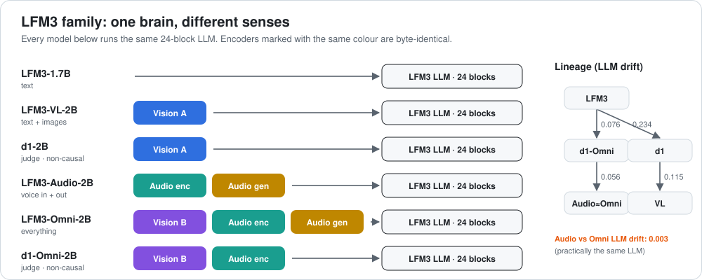

# d1-2B: a look inside the layers



[← all reviews](../README.md)

*Source: local GGUF files read with the `gguf` library. LLM file quant: Q6_K embeddings, 1,728,801,600 params.*

---

## 1. Summary

A **decision / judging model** built on the LFM3 skeleton plus a vision encoder. Attention is **non-causal** (every token sees every other token, both directions), and it carries **decision temperatures 1.337** for `noul` / `choice` / `score` outputs. Context 128k. It reads text and images and returns a judgement instead of free text.

---

## 2. The LLM in one picture

```
 tokens (vocab 128,000) ─► EMBEDDING 2048-wide (tied with output head)
          │
 ┌──────── 24 BLOCKS, two kinds, interleaved ────────────────────────────┐
 │ SHORT-CONV block  (13 of them: L0,1,3,5,…,23)   64.0M params each     │
 │   norm ─► short convolution "look at the last few tokens" ─► post-norm│
 │   norm ─► MLP 7,680 neurons                              ─► post-norm│
 │ GATED-ATTENTION block (11 of them: L2,4,…,22)    57.7M params each    │
 │   norm ─► attention 16 query / 4 key-value heads, gated  ─► post-norm│
 │   norm ─► MLP 7,680 neurons                              ─► post-norm│
 └───────────────────────────────────────────────────────────────────────┘
          │  attention L4,8,12,16,20 = sliding window 256; others global
          ▼
 OUTPUT NORM ─► OUTPUT HEAD (same matrix as embedding) ─► next token
```

| Item | Value |
|---|---|
| LLM parameters | 1,728,801,600 (same skeleton in all six LFM3 models) |
| Blocks | 24 = 13 short-conv + 11 gated-attention |
| Width | 2,048 |
| MLP neurons | 7,680 per block, 184,320 total |
| Attention | 16 query heads, 4 key/value heads, head size 128, q/k norms, output gate |
| Sliding window | 256 tokens on attention L4, 8, 12, 16, 20; L2, 6, 10, 14, 18, 22 see everything |
| RoPE base | 1,000,000 (global) / 10,000 (window) |
| Norms | pre-norm **and** post-norm ("sandwich") around every mixer and MLP |
| Embedding | 128,000 tokens, tied with output head |

---

## 3. What the layers do

> **Caveat:** numbers are measured from the weights (norm = mean |gain|, matrix = RMS of the first 256 rows after de-quantizing). The "what it means" readings are informed interpretation, not proven by activation probing.

| Zone | Blocks | What the numbers show | Likely job |
|---|---|---|---|
| **Entry** | 0–1 | conv mixer is strongest here (conv RMS highest at L0); MLP gain high at L1 | turn raw tokens into local word/phrase features |
| **Early mix** | 2–7 | first global attention at L2; post-norms still small | first look across the whole context |
| **Core** | 8–17 | flattest stretch; MLP gain lowest at L9 (0.097) | steady meaning-building; best place for edits |
| **Dead-ish attention** | 18 | q/k norm only 0.069/0.072 vs ~1.0+ elsewhere | attention scores here are nearly flat, so L18 attends almost uniformly; its MLP still works |
| **Exit** | 19–23 | post-norms climb to their max; MLP gain peaks (whole model) at L2, L22, L1, L4 | commit to the answer and shape the next token |

Other measured patterns:
- **Conv blocks** pre-norm gain 0.137–0.191; **attention blocks** pre-norm only 0.035–0.063. Attention gets a quieter input than conv.
- **Post-MLP norm** grows from 0.019 at L0 to 0.154 at L23: late blocks write louder into the stream.
- **q-norm** across attention blocks: 1.12, 1.02, 1.21, 1.01, 1.20, 1.04, 1.24, 0.99, 0.07, 0.98, 0.92 (L2→L22).
- **Output norm** 2.389.

### How far it moved from LFM3-1.7B

Mean relative change of every norm gain per block (0 = identical):

| L | 0 | 1 | 2 | 3 | 4 | 5 | 6 | 7 | 8 | 9 | 10 | 11 | 12 | 13 | 14 | 15 | 16 | 17 | 18 | 19 | 20 | 21 | 22 | 23 |
|---|---|---|---|---|---|---|---|---|---|---|---|---|---|---|---|---|---|---|---|---|---|---|---|---|
| drift | 0.19 | 0.16 | 0.14 | 0.21 | 0.15 | 0.19 | 0.19 | 0.15 | 0.18 | 0.16 | 0.22 | 0.19 | 0.21 | 0.19 | 0.22 | 0.19 | 0.21 | 0.19 | 0.22 | 0.18 | 0.20 | 0.14 | 0.20 | 0.13 |

Average **0.183**. Most changed: L10, L14, L18. Least changed: L23, L2, L21.

### Every LLM layer

`·` = tensor not present in that block type. Norms are gains; matrices are RMS.

#### d1 · `blk` (24 blocks)

| L | type | M params | attn_n | q | k | v | o | q_n | k_n | gate_a | ffn_n | f_gate | f_up | f_down | post_a | post_f | conv | conv_in | conv_out |
|---|---|---|---|---|---|---|---|---|---|---|---|---|---|---|---|---|---|---|---|
| 0 | conv | 64.0 | 0.185 | · | · | · | · | · | · | · | 0.157 | 0.0181 | 0.0168 | 0.0171 | 0.030 | 0.019 | 0.0461 | 0.0183 | 0.0189 |
| 1 | conv | 64.0 | 0.166 | · | · | · | · | · | · | · | 0.326 | 0.0202 | 0.0169 | 0.0172 | 0.026 | 0.019 | 0.0376 | 0.0178 | 0.0194 |
| 2 | attn | 57.7 | 0.045 | 0.0140 | 0.0155 | 0.0181 | 0.0171 | 1.116 | 1.073 | 0.0665 | 0.358 | 0.0210 | 0.0172 | 0.0167 | 0.012 | 0.016 | · | · | · |
| 3 | conv | 64.0 | 0.149 | · | · | · | · | · | · | · | 0.222 | 0.0190 | 0.0169 | 0.0169 | 0.034 | 0.016 | 0.0376 | 0.0176 | 0.0186 |
| 4 | attn | 57.7 | 0.054 | 0.0157 | 0.0161 | 0.0182 | 0.0170 | 1.015 | 0.977 | 0.0715 | 0.287 | 0.0198 | 0.0169 | 0.0167 | 0.014 | 0.016 | · | · | · |
| 5 | conv | 64.0 | 0.139 | · | · | · | · | · | · | · | 0.192 | 0.0185 | 0.0168 | 0.0166 | 0.044 | 0.018 | 0.0382 | 0.0175 | 0.0171 |
| 6 | attn | 57.7 | 0.051 | 0.0157 | 0.0155 | 0.0180 | 0.0178 | 1.214 | 1.178 | 0.0650 | 0.157 | 0.0179 | 0.0167 | 0.0166 | 0.019 | 0.017 | · | · | · |
| 7 | conv | 64.0 | 0.137 | · | · | · | · | · | · | · | 0.145 | 0.0181 | 0.0168 | 0.0164 | 0.056 | 0.019 | 0.0369 | 0.0173 | 0.0204 |
| 8 | attn | 57.7 | 0.050 | 0.0166 | 0.0155 | 0.0180 | 0.0177 | 1.009 | 0.979 | 0.0713 | 0.160 | 0.0181 | 0.0167 | 0.0164 | 0.020 | 0.018 | · | · | · |
| 9 | conv | 64.0 | 0.147 | · | · | · | · | · | · | · | 0.097 | 0.0171 | 0.0164 | 0.0163 | 0.050 | 0.022 | 0.0390 | 0.0173 | 0.0177 |
| 10 | attn | 57.7 | 0.052 | 0.0160 | 0.0155 | 0.0184 | 0.0176 | 1.205 | 1.182 | 0.0641 | 0.137 | 0.0180 | 0.0168 | 0.0165 | 0.029 | 0.024 | · | · | · |
| 11 | conv | 64.0 | 0.156 | · | · | · | · | · | · | · | 0.142 | 0.0177 | 0.0166 | 0.0165 | 0.050 | 0.026 | 0.0390 | 0.0174 | 0.0174 |
| 12 | attn | 57.7 | 0.055 | 0.0165 | 0.0159 | 0.0181 | 0.0176 | 1.038 | 1.003 | 0.0714 | 0.151 | 0.0179 | 0.0169 | 0.0167 | 0.034 | 0.030 | · | · | · |
| 13 | conv | 64.0 | 0.167 | · | · | · | · | · | · | · | 0.130 | 0.0179 | 0.0168 | 0.0169 | 0.054 | 0.036 | 0.0414 | 0.0178 | 0.0171 |
| 14 | attn | 57.7 | 0.055 | 0.0165 | 0.0156 | 0.0177 | 0.0175 | 1.237 | 1.206 | 0.0772 | 0.133 | 0.0180 | 0.0172 | 0.0169 | 0.057 | 0.047 | · | · | · |
| 15 | conv | 64.0 | 0.167 | · | · | · | · | · | · | · | 0.214 | 0.0185 | 0.0169 | 0.0169 | 0.067 | 0.042 | 0.0370 | 0.0177 | 0.0180 |
| 16 | attn | 57.7 | 0.063 | 0.0173 | 0.0153 | 0.0175 | 0.0172 | 0.992 | 0.967 | 0.0735 | 0.157 | 0.0180 | 0.0169 | 0.0169 | 0.040 | 0.045 | · | · | · |
| 17 | conv | 64.0 | 0.181 | · | · | · | · | · | · | · | 0.168 | 0.0181 | 0.0168 | 0.0169 | 0.072 | 0.051 | 0.0351 | 0.0178 | 0.0180 |
| 18 | attn | 57.7 | 0.035 | 0.0179 | 0.0077 | 0.0169 | 0.0144 | 0.069 | 0.072 | 0.0565 | 0.203 | 0.0184 | 0.0169 | 0.0169 | 0.021 | 0.054 | · | · | · |
| 19 | conv | 64.0 | 0.185 | · | · | · | · | · | · | · | 0.225 | 0.0188 | 0.0169 | 0.0170 | 0.085 | 0.063 | 0.0358 | 0.0180 | 0.0178 |
| 20 | attn | 57.7 | 0.056 | 0.0180 | 0.0155 | 0.0176 | 0.0180 | 0.977 | 0.955 | 0.0851 | 0.163 | 0.0182 | 0.0169 | 0.0169 | 0.067 | 0.068 | · | · | · |
| 21 | conv | 64.0 | 0.191 | · | · | · | · | · | · | · | 0.170 | 0.0180 | 0.0167 | 0.0168 | 0.101 | 0.088 | 0.0369 | 0.0179 | 0.0181 |
| 22 | attn | 57.7 | 0.043 | 0.0154 | 0.0141 | 0.0178 | 0.0178 | 0.920 | 0.859 | 0.0875 | 0.327 | 0.0195 | 0.0171 | 0.0169 | 0.127 | 0.096 | · | · | · |
| 23 | conv | 64.0 | 0.178 | · | · | · | · | · | · | · | 0.282 | 0.0190 | 0.0169 | 0.0169 | 0.114 | 0.154 | 0.0409 | 0.0181 | 0.0178 |

---

## 4. The extra senses (projector file `mmproj`, 189.4M params)

### Vision encoder (`v.blk`, 14 blocks)

Images are cut into 16×16 patches (two F16 patch-embedding tensors, 3→1024), then pass 14 encoder blocks of width 1,024 (MLP 2,560):
- **8 conv blocks** (`c_in` / `c_sp` / `c_out`: in-projection, spatial depthwise conv, out-projection);
- **6 attention blocks** at L2, 4, 6, 8, 10, 12.

Measured highlights:
- **L12 attention** has the largest value/output weights of the encoder: it gathers the final image summary.
- **L13 MLP down-projection collapses** (much smaller than every other block): an output bottleneck before the adapter.
- **Adapter:** `mm.input_norm` → `mm.0` [4096×4096] → `mm.2` [4096→2048]. It folds patches into the LLM's 2,048-wide stream.

### Every projector layer

#### d1_proj · `v.blk` (14 blocks)

| L | type | M params | q | k | v | o | q_n | k_n | f_gate | f_up | f_down | c_in | c_sp | c_out | ln1 | ln2 |
|---|---|---|---|---|---|---|---|---|---|---|---|---|---|---|---|---|
| 0 | conv | 12.1 | · | · | · | · | · | · | 0.0316 | 0.0321 | 0.0261 | 0.0245 | 0.0441 | 0.0266 | 0.142 | 0.060 |
| 1 | conv | 12.1 | · | · | · | · | · | · | 0.0324 | 0.0320 | 0.0307 | 0.0247 | 0.0456 | 0.0306 | 0.144 | 0.055 |
| 2 | attn | 11.0 | 0.0312 | 0.0298 | 0.0294 | 0.0295 | 0.787 | 0.789 | 0.0322 | 0.0326 | 0.0306 | · | · | · | 0.008 | 0.052 |
| 3 | conv | 12.1 | · | · | · | · | · | · | 0.0324 | 0.0317 | 0.0316 | 0.0300 | 0.0399 | 0.0305 | 0.157 | 0.057 |
| 4 | attn | 11.0 | 0.0310 | 0.0312 | 0.0323 | 0.0316 | 0.928 | 0.943 | 0.0341 | 0.0317 | 0.0311 | · | · | · | 0.011 | 0.060 |
| 5 | conv | 12.1 | · | · | · | · | · | · | 0.0329 | 0.0309 | 0.0312 | 0.0311 | 0.0440 | 0.0306 | 0.166 | 0.068 |
| 6 | attn | 11.0 | 0.0329 | 0.0324 | 0.0347 | 0.0346 | 0.960 | 0.961 | 0.0329 | 0.0314 | 0.0315 | · | · | · | 0.016 | 0.077 |
| 7 | conv | 12.1 | · | · | · | · | · | · | 0.0338 | 0.0308 | 0.0311 | 0.0330 | 0.0450 | 0.0320 | 0.200 | 0.090 |
| 8 | attn | 11.0 | 0.0313 | 0.0315 | 0.0356 | 0.0348 | 1.011 | 1.004 | 0.0354 | 0.0320 | 0.0320 | · | · | · | 0.028 | 0.106 |
| 9 | conv | 12.1 | · | · | · | · | · | · | 0.0356 | 0.0321 | 0.0325 | 0.0348 | 0.0479 | 0.0335 | 0.259 | 0.125 |
| 10 | attn | 11.0 | 0.0325 | 0.0316 | 0.0373 | 0.0386 | 0.964 | 0.964 | 0.0375 | 0.0339 | 0.0349 | · | · | · | 0.039 | 0.130 |
| 11 | conv | 12.1 | · | · | · | · | · | · | 0.0347 | 0.0363 | 0.0392 | 0.0358 | 0.0562 | 0.0352 | 0.259 | 0.138 |
| 12 | attn | 11.0 | 0.0303 | 0.0300 | 0.0543 | 0.0455 | 0.935 | 0.921 | 0.0392 | 0.0399 | 0.0423 | · | · | · | 0.054 | 0.135 |
| 13 | conv | 12.1 | · | · | · | · | · | · | 0.0412 | 0.0442 | 0.0193 | 0.0218 | 0.0284 | 0.0204 | 0.146 | 0.182 |

---

## 5. What's strong

1. **Bidirectional attention** reads the whole input at once: better for scoring and choosing than a left-to-right chatter.
2. **Vision built in:** identical encoder to LFM3-VL, so image understanding is shared.
3. **Changes are spread evenly** (drift 0.13–0.22 in every block): a full re-train of the head behaviour, not a patch on a few layers.

## 6. Weak spots

1. **Not a chat model.** Non-causal attention means normal next-token generation is not what it is built for.
2. **L18 attention is even weaker** (q/k ≈0.07) than in the base.
3. **Different lineage:** it sits in the {d1, VL} lineage, far from LFM3-Audio/Omni (drift 0.4+).

---

## 7. Surgical map

| Goal | Best place | Why |
|---|---|---|
| Fact / habit edit (ROME-style) | **MLP of L8–17** | flattest, lowest-gain core; edits stay contained |
| Steering vector | **residual after L10–16** | middle of the stack, before the exit zone amplifies |
| LoRA | **attention q/v/o of L2–16 + MLP L8–17** | attention blocks are few (11), so this is cheap |
| Revive / prune | **L18 attention** | near-flat attention; candidate to prune or to re-train with a small LoRA |
| Leave alone | **L0–1 and L21–23** | entry builds token features; exit has the highest gains and drift |
| Projector | **adapter (`mm.*`) only** | the encoders are shared with sibling models; tune the adapter, not the tower |

---

## 8. Verdict

d1-2B is a **1.73B-param LFM3 hybrid** (13 conv + 11 attention blocks) that fits easily on a 6 GB GPU. Its layers follow the family plan: busy entry, quiet core, near-off L18 attention, loud exit. Edit in the core, protect the ends.
